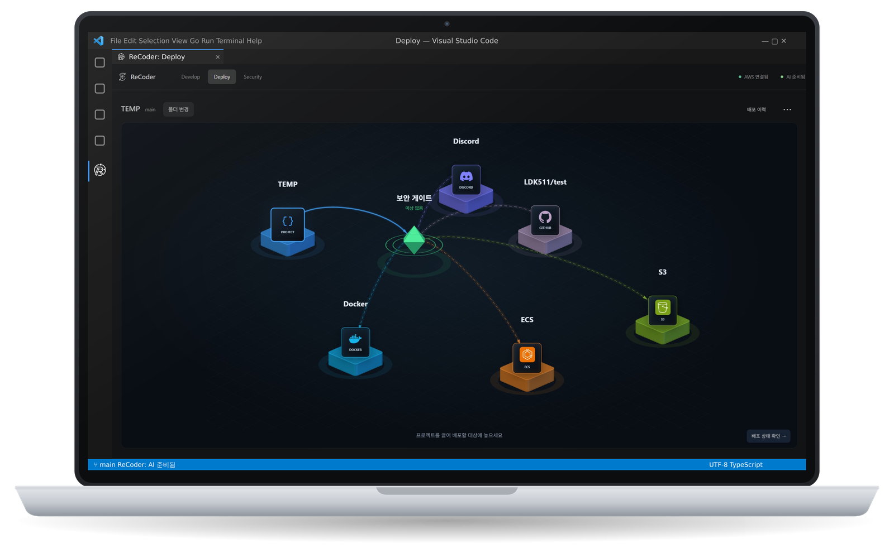
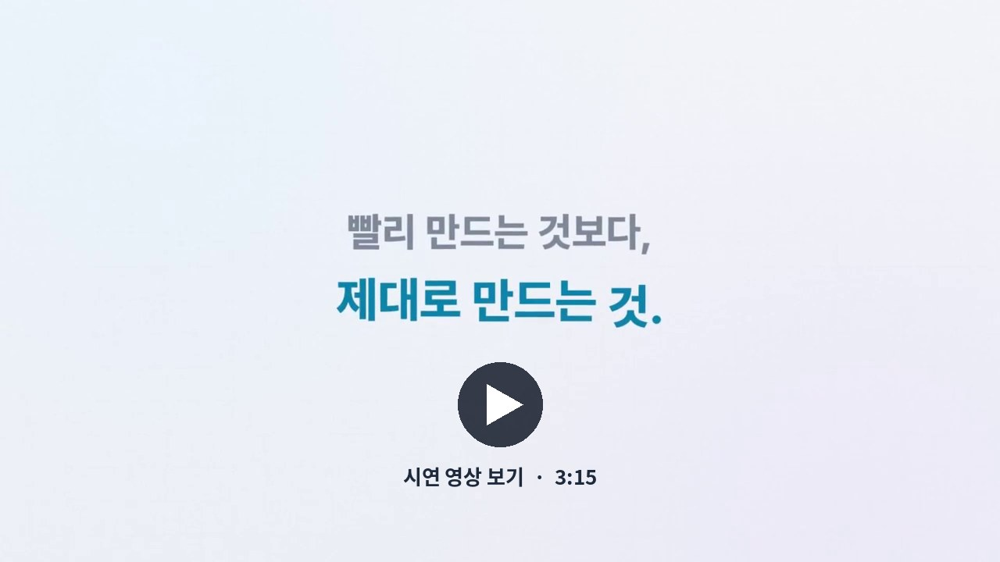
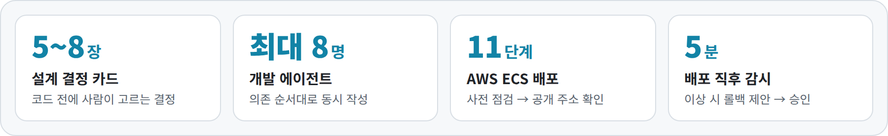
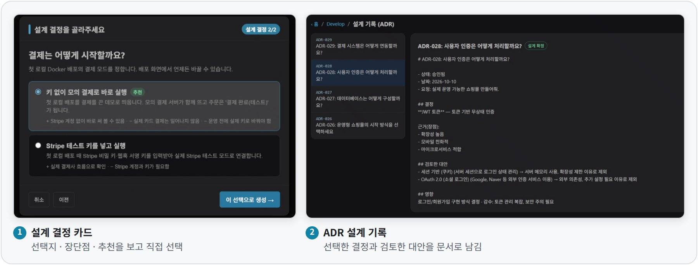
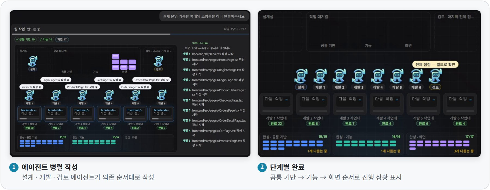
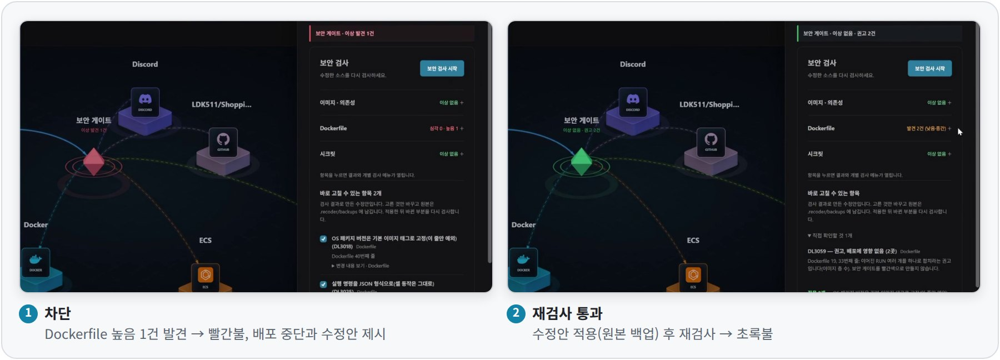
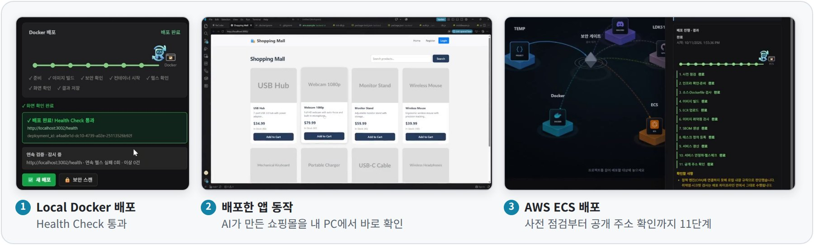
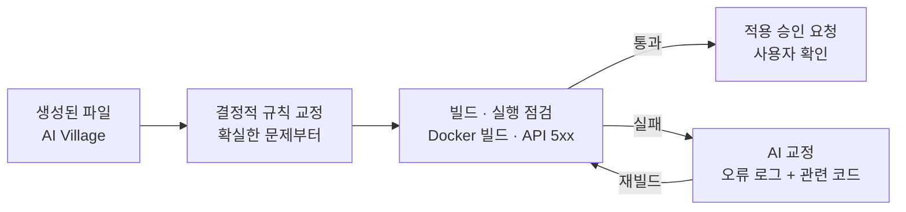
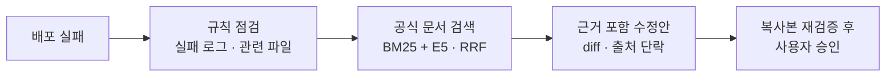

<div align="center">

<picture>
  <source media="(prefers-color-scheme: dark)" srcset="docs/images/readme/logo-white.png">
  
</picture>

# ReCoder

**코드 생성부터 보안 검사와 배포까지, VS Code 안의 AI DevOps 에이전트**

From Prompt to Production — 만드는 속도만큼, 안전하게.

<br>


[**시연 영상**](https://youtu.be/8W2SarV1orU) &nbsp;·&nbsp; [**발표 자료**](발표자료/ReCoder_2학기_중간발표.pptx) &nbsp;·&nbsp; [**구현 설계서**](docs/ReCoder_구현설계서_v2.md) &nbsp;·&nbsp; [**설치 · 실행**](#설치--실행)

</div>

<br>

<p align="center">
  
</p>

ReCoder는 VS Code 확장으로 동작하는 AI DevOps 에이전트입니다. 자연어 요청 하나로 **설계 결정 → 코드 생성 → 빌드 검증 → 보안 검사 → 배포 → 배포 후 감시**까지 이어서 진행합니다. AI는 만들고 고치는 일을 맡고, 무엇을 적용하고 배포할지는 사람이 승인합니다.

<br>

<div align="center">

[시연 영상](#시연-영상) · [발표 자료](#발표-자료) · [프로젝트 소개](#프로젝트-소개) · [핵심 기능](#핵심-기능) · [전체 기능 목록](#전체-기능-목록) · [시스템 아키텍처](#시스템-아키텍처) · [AI 파이프라인](#ai-파이프라인)<br>
[보안 설계](#보안-설계) · [검증 결과](#검증-결과) · [기술 스택](#기술-스택) · [설치 · 실행](#설치--실행) · [문서](#문서) · [버전 기록](#버전-기록) · [팀](#팀)

</div>

<br>

## 시연 영상

<p align="center">
  <a href="https://youtu.be/8W2SarV1orU">
    
  </a>
  <br>
  <sub>이미지를 누르면 YouTube 시연 영상(3:15)으로 이동합니다 · <a href="https://youtu.be/8W2SarV1orU">https://youtu.be/8W2SarV1orU</a></sub>
</p>

| 시간 | 장면 |
|:---:|---|
| [0:00](https://youtu.be/8W2SarV1orU?t=0) | 문제 제기 — 코드는 빨리 만들지만, 배포 · 보안 · 운영은 여전히 혼자 |
| [0:36](https://youtu.be/8W2SarV1orU?t=36) | **AI-DLC** — 요청 입력, 설계 결정 카드 선택 |
| [0:57](https://youtu.be/8W2SarV1orU?t=57) | **AI Village** — 설계 · 개발 · 검토 에이전트의 병렬 개발 |
| [1:18](https://youtu.be/8W2SarV1orU?t=78) | 프로젝트에 적용 → ADR 기록 → 구조 지도 |
| [1:36](https://youtu.be/8W2SarV1orU?t=96) | **보안 게이트** — 차단 → 수정 → 재검사 |
| [1:54](https://youtu.be/8W2SarV1orU?t=114) | **배포 캔버스** Step 1 — GitHub 검사 후 푸시 |
| [2:09](https://youtu.be/8W2SarV1orU?t=129) | Step 2 — Local Docker 승인 후 실행, 쇼핑몰 동작 확인 |
| [2:36](https://youtu.be/8W2SarV1orU?t=156) | Step 3 — AWS ECS 11단계 배포 |

<br>

## 발표 자료

| 발표 | 시기 | 주요 내용 | 자료 |
|---|:---:|---|:---:|
| 프로젝트 제안서 발표 (중간) | 2026 1학기 | 시장 배경, 프로젝트 개요, 경쟁 서비스 비교, 핵심 기능 · 아키텍처, 데모 시나리오 | [PPT](발표자료/ReCoder_중간발표.pptx) |
| 1학기 기말 발표 | 2026 1학기 | 문제 정의 · 수요 근거, 대상 사용자, 워크플로, 시스템 아키텍처, 구현 현황, 로드맵 | [PPT](발표자료/ReCoder_기말발표.pptx) |
| 2학기 중간 발표 | **2026.10.13** | 문제 정의, 서비스 소개, 기능별 심층 분석, 시연, 기대 효과, RAG 실험 결과 · 한계, 확장 방향 | [**PPT**](발표자료/ReCoder_최종발표.pptx) |


<br>

## 프로젝트 소개

AI 코딩 도구로 코드를 만드는 일은 쉬워졌지만, 만든 코드를 검증하고 안전하게 배포하는 일은 여전히 사람이 도구를 하나씩 이어 붙여야 합니다. ReCoder는 이 과정을 VS Code 안의 한 흐름으로 묶고, 단계마다 검증과 승인을 넣었습니다.

<picture>
  <source media="(prefers-color-scheme: dark)" srcset="docs/images/readme/flow-dark.png">
  
</picture>

### 왜 필요한가

| 현상 | 근거 |
|---|---|
| AI 코딩은 개발의 기본 도구가 됨 | 구글 엔지니어가 검토 · 채택하는 신규 코드의 75%가 AI 작성 ([테크42, 2026.04.24](https://v.daum.net/v/20260424074412149)) · 개발자 90%가 업무에 AI 도구를 정기적으로 사용 ([JetBrains 조사, 다나와 2026.04.29](https://dpg.danawa.com/news/view?boardSeq=60&listSeq=6003754)) |
| 코드 다음 단계가 병목 | 바이브코딩 후속 개발 문의가 2분기에 전 분기 대비 약 200% 증가, 가장 많이 찾는 단계는 배포 · 출시 ([아이뉴스24, 2026.09.30](https://m.inews24.com/v/2010218)) |
| 생성 후 검증 없는 코드는 위험 | AI 코딩 도구 5종으로 만든 앱 15개에서 취약점 69개, 그중 치명적 6개 ([Tenzai 평가, CIO Korea 2026.01.15](https://www.cio.com/article/4117131/)) |

### 설계 원칙

<table>
  <tr>
    <td width="50%" valign="top">
      <b>사람이 결정</b><br>
      설계 선택 · 파일 적용 · 배포 · 롤백은 사용자가 승인한 것만 실행합니다. AI가 만든 코드는 변경 목록으로 돌아오고, 파일 쓰기는 승인 뒤에 일어납니다.
    </td>
    <td width="50%" valign="top">
      <b>결정적 규칙이 먼저, AI는 나중</b><br>
      확실한 문제는 규칙으로 먼저 고치고, 남은 빌드 · 실행 오류만 로그와 함께 AI 교정에 넘깁니다. 교정해도 오류가 줄지 않으면 멈추고, 더 나빠졌으면 직전 상태로 되돌립니다.
    </td>
  </tr>
  <tr>
    <td width="50%" valign="top">
      <b>검사하지 못하면 통과도 없음</b><br>
      보안 도구가 문제를 찾거나, 도구를 실행하지 못했거나, 결과를 읽지 못하면 배포를 막습니다.
    </td>
    <td width="50%" valign="top">
      <b>내 PC, 내 계정</b><br>
      Core는 <code>127.0.0.1</code>에서만 열리고 세션 토큰으로 보호됩니다. 클라우드 배포는 사용자 본인의 AWS 계정으로 실행합니다.
    </td>
  </tr>
</table>

### ReCoder

<picture>
  <source media="(prefers-color-scheme: dark)" srcset="docs/images/readme/stats-dark.png">
  
</picture>

<br>

## 핵심 기능

### 1. AI-DLC 설계 결정

코드를 바로 만들지 않고, 사람이 정해야 할 설계 결정을 먼저 카드로 제시합니다.

- 새 앱은 결정 카드 5~8장 (기술 → 데이터 → 인증 → 기능 규칙 순서), 고른 선택에 따라 이어서 물을 결정이 추가됨
- 카드마다 선택지 2~4개와 장단점, 추천 표시 · 설계 갈림길이 없는 작은 요청은 확인 창 하나로 진행
- 고른 결정은 코드 생성 지시에 반영되고, 같은 내용이 `docs/adr/ADR-NNN-*.md`로 남음

<picture>
  <source media="(prefers-color-scheme: dark)" srcset="docs/images/readme/feature-dlc-dark.jpg">
  
</picture>

### 2. AI Village 병렬 개발

큰 요청은 파일 목록을 먼저 설계한 뒤, 여러 AI 에이전트가 나눠서 씁니다.

- 공통 기반 → 기능 → 화면의 의존 순서를 지키고, 먼저 끝난 파일의 실제 내용을 보고 다음 파일 작성
- **공용 게시판** — 서버 API 파일이 끝나면 실제 경로 · 응답 키 · 로그인 필요 여부를 뽑아 화면 코드에 전달 (AI 호출 없음)
- **의존 관문** — 파일이 끝날 때마다 내보내기 누락 · 타입 어긋남을 바로 검사하고, 기계적으로 고칠 수 있으면 즉시 수정
- 중간에 끊겨도 체크포인트에서 이어서 생성

<picture>
  <source media="(prefers-color-scheme: dark)" srcset="docs/images/readme/feature-village-dark.jpg">
  
</picture>

### 3. 보안 게이트

배포 전에 세 가지 보안 도구를 실행하고, 결과를 OPA 정책으로 판정합니다.

- **Trivy** 이미지 · 의존성 취약점 · **Hadolint** Dockerfile · **Gitleaks** 시크릿 → **OPA** [`deploy.rego`](policies/recoder/deploy.rego)로 허용 여부 결정
- 바로 고칠 수 있는 항목은 수정안을 보여 주고, 적용하면 원본을 `.recoder/backups/`에 남긴 뒤 재검사
- **AI 코드 보안 점수** — SQL 인젝션 · 인증 누락 · 평문 비밀번호 등 AI가 자주 하는 보안 실수 9가지를 규칙으로 점검
- **슬롭스쿼팅 방어** — AI가 지어내거나 흉내 낸 npm 패키지를 설치 전에 차단

<picture>
  <source media="(prefers-color-scheme: dark)" srcset="docs/images/readme/feature-gate-dark.jpg">
  
</picture>

### 4. Drag & Drop 배포 · 운영

배포 캔버스에서 프로젝트를 배포 대상 위로 끌어 놓고, 설정 확인과 승인을 거쳐 배포합니다. 놓기만으로는 배포되지 않습니다.

| 대상 | 동작 |
|---|---|
| **GitHub** | 보안 검사 후 푸시, 저장소 생성 · 연결, GitHub Actions 워크플로 생성 |
| **Local Docker** | AWS 키 없이 빌드 → 실행 → Health Check, 통과한 뒤에만 기존 컨테이너 교체, 실패하면 이전 이미지로 복구 |
| **AWS ECS Fargate** | 사전 점검 → 인프라 준비 → 소스 · Dockerfile 검사 → 이미지 빌드 → ECR 업로드 → 이미지 취약점 검사 → SBOM 생성 → 태스크 정의 등록 → 서비스 갱신 → 안정화 · 헬스체크 → 공개 주소 확인 |
| **Amazon S3** | 정적 사이트 빌드 결과를 사용자 계정 버킷에 업로드 |

- 배포 직후 5분 동안 헬스 · 오류 로그를 감시하고, 이상이 있으면 이전 버전 롤백을 제안 → 승인 후 실행
- 선택 구성: HTTPS 주소(CloudFront · 내 도메인), 관리형 DB(RDS), 앞단 방패(nginx 속도 제한 · ALB + AWS WAF), 공격 · 장애 감지 알림, AWS 리소스 정리

<picture>
  <source media="(prefers-color-scheme: dark)" srcset="docs/images/readme/feature-deploy-dark.jpg">
  
</picture>

<br>

## 전체 기능 목록

VS Code 확장은 **Develop · Deploy · Security** 세 화면으로 구성됩니다.

#### Develop — 요청부터 코드 적용까지

| 기능 | 설명 |
|---|---|
| 코드 생성 · 수정 | 채팅 요청 → 설계 카드 → 생성 → 변경 내용(diff) 확인 → 적용, 시크릿 경고 |
| 에러 분석 | 터미널 오류의 원인 분석과 수정 패치 제안, 승인 후 적용 |
| 아키텍처 (구조 지도) | 파일 import 관계 → 함수 호출 그래프의 2단계 지도, 고립 · 과부하 파일 표시 |
| 흐름 dry run | API 경로 · 화면 동작 · 실행 파일을 골라 요청이 지나가는 함수를 호출 순서대로 재생, 적용 전 흐름 미리 보기 |
| 설계 기록 (ADR) | 이전에 결정한 설계와 선택 이유 열람 |
| AI 공급자 · 비용 | 작업 등급(품질 · 절약)별 공급자 선택, 비용 원장, 같은 요청을 두 공급자로 돌려 비교 |

#### Deploy — 로컬 Docker부터 AWS까지

| 기능 | 설명 |
|---|---|
| 로컬 Docker 배포 | Dockerfile 생성 → 검사 → 빌드 → 실행 → 헬스 체크, 실패 시 이전 이미지로 복구 |
| 배포 캔버스 | GitHub · Docker · ECS · S3 Drag & Drop 배포(3D 캔버스), 승인 · 보안 검사 · 실행 상태 표시 |
| 제로 트러스트 점검 | 배포 승인 화면에서 5가지 원칙 기준으로 통과 · 주의 · 막힘 표시 |
| 롤백 · Replay | 배포 · 롤백 이력과 이전 버전 복귀 대상 확인 |
| 운영 대응 | 장애 감지 → 원인 분석 → 조치 제안, 실행은 승인 후 |
| 공격 · 장애 감지 알림 | ECS 앱의 요청 급증 · 차단 비율 · 오류 비율 · 태스크 부족 감지, IP 차단 · 방패 강화 · 태스크 증설 · 이전 버전 제안 |
| AWS 리소스 정리 | ReCoder가 만든(태그가 붙은) 리소스만 찾아 중지 또는 완전 삭제 |

#### Security — 배포 전 검사와 정책

| 기능 | 설명 |
|---|---|
| 취약점 스캔 | Trivy · Hadolint로 이미지 · 의존성 · Dockerfile 검사 |
| 시크릿 검사 | Gitleaks + 내장 스캐너로 소스에 남은 키 · 비밀번호 검사 (값은 가려서 표시) |
| 정책 게이트 | 배포 승인 · 차단 기준과 OPA 규칙 원문 확인 |
| 배포 후 취약점 재검사 | 하루 한 번 SBOM을 공개 취약점 DB(OSV)와 다시 대조해 새 취약점만 알림, 버전 올리기 제안 |

#### 연동 · 운영 구성 (선택)

| 구성 | 설명 |
|---|---|
| Discord 봇 | `/recoder` 명령으로 개발 · 배포 · 롤백 · 사전 점검 · 상태 조회, 알림 채널 |
| Watchdog | EC2 · ECS 컨테이너 감시 데몬 — 크래시 · 헬스 실패 · OOM · 5xx 급증 · 지연 감지, Discord 알림 |
| ReCoder Gateway | 운영자 AWS 계정의 서버리스 AI 대행 — 학생은 반 코드로 AWS 키 없이 사용, 사용자별 쿼터 · 전체 비용 상한 |
| Control Plane | 조직 · 프로젝트 관리, OIDC 로그인, 기기 등록, 정책 번들, 다중 승인, 해시 체인 감사 로그 |

<br>

## 시스템 아키텍처

<p align="center">
  
</p>

| 구성 요소 | 위치 | 역할 |
|---|---|---|
| **VS Code 확장** | 개발자 PC | 요청 · 진행 상태 · 승인 화면, Core 자동 실행, 승인된 변경만 파일에 기록 |
| **Local Core** | 개발자 PC (`127.0.0.1:17894~17910`) | AI 호출, 생성 · 검증 · 보안 검사 · 배포 오케스트레이션 (FastAPI 라우터 22개) |
| **Docker** | 개발자 PC | 검증 빌드, 실행 점검, 로컬 배포, 보안 도구 실행 |
| **AI 모델** | 외부 | Amazon Bedrock · ReCoder Gateway · Claude API · OpenAI(호환) API 중 하나를 연결 |
| **사용자 AWS 계정** | 클라우드 | ECR 이미지 저장, ECS Fargate 실행, S3 정적 호스팅, CloudWatch 로그 |
| **협업 · 알림** | 외부 | GitHub 푸시 · Actions, Discord 알림 · ChatOps |

<details>
<summary><b>프로젝트 구조</b></summary>

```text
Re-Coder/
├── extension/            VS Code 확장 (TypeScript · React · Tailwind · three.js)
│   ├── src/              확장 본체 — Core 실행, 명령 23개, 웹뷰 메시지 처리
│   └── webview-src/      Develop · Deploy · Security 화면, 배포 캔버스, AI Village
├── core/                 Local Core (Python · FastAPI)
│   ├── api/routes/       REST 라우터 22개
│   ├── llm/              AI 공급자 · 작업 등급 · 비용 원장 · 비밀값 가리기
│   ├── agents/           ECS 배포 · 인프라 · 사전 점검 · 장애 대응 에이전트
│   ├── grounded_repair/  문서 근거 수정(RAG)
│   └── tests/            단위 · 통합 테스트
├── gateway/              ReCoder Gateway (AWS SAM · Lambda · DynamoDB)
├── control_plane/        조직 거버넌스 (FastAPI · PostgreSQL · OPA)
├── watchdog/             EC2 · ECS 감시 데몬
├── discord-bot/          Discord 봇 (discord.py)
├── policies/recoder/     OPA 배포 정책 (Rego)
├── infra/                IAM 권한 템플릿 · HTTPS 인프라 · 문서 갱신 스택
├── benchmarks/           쇼핑몰 통합 검사 · RAG 수정 실험
├── scripts/              골든패스 스모크 · 릴리스 빌드 · 실험 실행기
├── docs/                 구현 설계서 · ADR · API · 검증 문서
└── 발표자료/              제안서 · 기말 · 최종 발표 PPT
```

</details>

<br>

## AI 파이프라인

생성 직후에는 결정적 규칙으로 확실한 문제를 먼저 고치고, Docker 빌드와 실행 점검을 통과한 결과만 적용 승인을 요청합니다.



- 검증 빌드는 비밀값을 걸러 낸 임시 사본에서 실행하고, 원본 프로젝트는 건드리지 않음
- 실행 점검은 이미지를 실제로 띄워 사용자 흐름의 API를 호출하고 5xx · 기동 실패를 잡음
- AI 교정은 최대 6회 · 시간 예산 안에서 진행하고, 오류가 줄지 않으면 멈춤

배포 중 빌드 · ECS 오류가 나면 **문서 근거 수정(RAG)** 경로를 사용할 수 있습니다.



- 색인: 직접 작성 요약 10개 + 라이선스를 검토한 공식 문서 원문 148개 = 158개 단락
- 검색: BM25와 `multilingual-e5-small` 임베딩(로컬 CPU)을 RRF로 결합, 정확한 오류 코드 우선
- ECS · IAM · S3 환경 오류는 빌드 통과만으로 승인하지 않고 수동 확인으로 남기며, 재배포는 별도 승인

<details>
<summary><b>RAG 비교 실험 결과 (2026-10-03, 36개 과제 × 4조건 = 144회)</b></summary>

| 조건 | AI 과제 해결 | 해결률 | 모델 비용 | 해결 1건당 비용 |
|---|:---:|:---:|---:|---:|
| A 대형 모델 단독 | 30/32 | **93.8%** | $0.29845 | $0.00995 |
| B 대형 + 문서 | 20/32 | 62.5% | $0.70902 | $0.03545 |
| C 소형 + 문서 | 18/32 | 56.2% | $0.26606 | $0.01478 |
| D 소형 → 대형 + 문서 | 21/32 | 65.6% | $0.41530 | $0.01978 |

- 과제: npm · Node/프레임워크 · Docker · ECS/ECR · IAM/S3 · 로직 대조군 각 6개, 규칙이 처리한 4개는 분모에서 제외
- **"문서를 붙이면 좋아진다"는 가설은 이번 실험에서 확인되지 않았습니다.** 대형 모델 단독(A)이 해결률이 가장 높고 해결당 비용도 가장 낮았습니다.
- 로직 오류 대조군 6개는 문서 근거 조건(B · D)에서 자동 수정 0건 — 로직 오류는 자동 수정 대신 사람의 검토로 넘깁니다.
- 조건별 1회(seed 42) 탐색 실험이며 통계적 우월성을 뜻하지 않습니다. 총 모델 사용료 추정 $5.49 (승인 상한 $30).
- 상세: [실험 보고서](benchmarks/repair/RESULTS.md) · [문서 근거 수정 설계](docs/document-grounded-repair.md)

</details>

<br>

## 보안 설계

### 배포 게이트

- **검사** — Trivy(이미지 · 의존성) · Hadolint(Dockerfile) · Gitleaks(시크릿). 도구가 설치돼 있지 않으면 공식 Docker 이미지로 대신 실행하고, 둘 다 안 되면 차단
- **판정** — OPA [`deploy.rego`](policies/recoder/deploy.rego): SBOM 없음 · Trivy critical 1건 이상 · 시크릿 발견 · Dockerfile 오류 · 허용되지 않은 브랜치의 production 배포는 거부
- **폴백** — OPA 서버가 없으면 같은 규칙을 Core의 로컬 구현으로 적용 (두 구현은 같은 판단을 하도록 함께 관리)
- **승인** — 승인 레벨 4단계: 자동(1) · 확인(2) · 이중 확인(3) · 차단(4)

### AI 에이전트 자체의 보안

AI 에이전트가 사용자 PC에서 코드를 만들고 실행하는 만큼, ReCoder 자신이 공격 경로가 되지 않도록 [OWASP Top 10 for Agentic Applications](https://genai.owasp.org/)를 기준으로 대응했습니다.

| 위험 | 대응 |
|---|---|
| 숨은 지시 (ASI01) | 첨부 · 참고 파일에서 "이전 지시를 무시하라" 같은 줄을 AI에 보내기 전에 빼고, 파일 내용은 데이터로 표시 |
| 위험한 Dockerfile (ASI02 · ASI05) | 내려받아 바로 실행, 호스트 Docker 소켓 접근, 비밀값 외부 전송이 있으면 빌드 전에 차단 |
| 과도한 권한 (ASI03) | AWS 루트 키 연결 시 경고, 권한 템플릿은 `recoder-*` 리소스와 태그 조건으로 제한 |
| 기억 오염 (ASI06) | 검증을 통과한 교정 기록에 서명(HMAC), 바뀐 기록은 재사용하지 않음 |
| 도구 호출 추적 (ASI07) | MCP 도구 호출을 시각 · 도구 · 인자 이름으로 기록 (값은 남기지 않음) |
| 승인 근거 조작 (ASI09) | 승인 카드에 실제 실행할 요청 · 위치 · 파일을 표시하고, AI가 쓴 요약은 따로 구분 |

이 밖에 외부 AI로 나가는 문맥의 비밀값 가리기, 알려진 유명 npm 패키지(17,817개) 기준 슬롭스쿼팅 판정, 배포 승인 화면의 제로 트러스트 점검(AI 결과 · 최소 권한 · 네트워크 · 비밀값 · 기록과 되돌리기)을 적용합니다.

<br>

## 검증 결과

| 대상 | 결과 |
|---|---|
| CI 구성 | Core pytest (Ubuntu · Windows · macOS, Python 3.11 · 3.13), 웹뷰 렌더, 골든패스, Watchdog, Discord, 쇼핑몰 통합, 의존성 감사 |
| 테스트 (2.0.30) | Core 2,831 · 확장 화면 574 · Watchdog 65 · Discord 112 — 모두 통과 |
| 쇼핑몰 기반 (2026-10-09) | 독립 PostgreSQL · 모의 결제 서버 통합 검사 50개 통과 |
| 실제 AWS 배포 (2026-10-09) | CloudFront · 내부 ALB · ECS · ECR · RDS · IAM · Secrets Manager 환경에서 업무 · 보안 검사 36개 통과 |
| DB 복구 | 암호화 RDS 스냅숏 → 새 DB → 재배포 후 회원 · 결제 완료 주문 · 재고 유지 6개 통과 |
| 롤백 | 고의 헬스체크 실패 감지 → 롤백 제안 → 승인 → 이전 정상 리비전 복구, 결제 완료 주문 유지 |
| 읽기 부하 | Fargate 태스크 1개(256 CPU unit · 512MiB)에서 50 동시 · 500 요청 p95 585ms, 오류 0 |
| 의존성 감사 | 루트 · 확장 · 쇼핑몰 npm, 세 플랫폼 Python 배포 목록에서 알려진 취약점 0 |

> [!NOTE]
> 실제 AWS 계정 검증은 2026-10-09 기준입니다. 이후 2.0.25~2.0.36에서 추가한 WAF · CloudFront · ACM · RDS 자동 생성, 원본 잠금, OSV 재검사는 모의 AWS(moto) · 로컬 · 실제 nginx로 검증했습니다. 모의 결제 통과는 실제 결제사 승인을 뜻하지 않습니다. 자세한 범위는 [생성 · 배포 · 보안 검증 범위](docs/production-readiness.md)를 참고하세요.

<br>

## 기술 스택

| 영역 | 기술 |
|---|---|
| **VS Code 확장** |      |
| **Local Core** |     |
| **AI** |     |
| **보안** |      |
| **클라우드 · 배포** |     |
| **운영 · 협업** |    |

<br>

## 설치 · 실행

**필요 환경** — Python 3.11+, Node.js 20+, VS Code 1.85+, Docker Desktop(검증 빌드 · 로컬 배포), AWS 계정(ECS · S3 배포 시)

```bash
git clone https://github.com/team-chain/Re-Coder.git
cd Re-Coder

# 1) Local Core — http://127.0.0.1:17894 (사용 중이면 17895~17910)
cd core
python -m venv .venv
source .venv/bin/activate          # Windows: .\.venv\Scripts\Activate.ps1
pip install -r requirements.txt
python main.py

# 2) VS Code 확장
cd ../extension
npm install
npm run build                      # VS Code에서 extension 폴더를 열고 F5 → Extension Development Host
```

**AI 연결** — 명령 팔레트(`Ctrl/Cmd + Shift + P`)에서 하나를 고릅니다.

| 방법 | 명령 |
|---|---|
| Amazon Bedrock (내 AWS 자격 증명) | `ReCoder: Configure AWS Credentials` |
| ReCoder Gateway (운영자가 준 반 코드, AWS 키 불필요) | `ReCoder: Connect to Gateway (Enroll)` |
| Claude API · OpenAI API · OpenAI 호환 API | `ReCoder: Connect AI with API Key` |

설치 파일(VSIX)은 `v*` 태그를 push하면 GitHub Actions가 Windows · Linux · macOS용으로 빌드해 GitHub Release에 올립니다. 운영자용 전체 설정(게이트웨이 · Discord 봇 · VSIX 직접 빌드)은 [SETUP.md](SETUP.md)를 참고하세요.

### 골든패스 스모크

핵심 흐름(설계 결정 → 코드 생성 → ADR → S3 배포)이 아직 이어져 있는지 한 번에 확인합니다. 단위 테스트는 조각별 동작만 보므로, 조각 사이의 **배선**이 끊긴 회귀는 이 스모크가 잡습니다.

```bash
pip install -r core/requirements.txt -r core/requirements-dev.txt

# 기본 — 픽스처 LLM + moto S3. 비용 0, 수 초. PR 머지 전마다.
python scripts/golden_path_smoke.py

# 실제 Bedrock + 실제 S3 버킷까지. 하루 1회 또는 발표 리허설 전.
python scripts/golden_path_smoke.py --live
```

기본 모드는 CI(`.github/workflows/ci.yml`)에서 develop 대상 PR과 push마다 자동으로 실행됩니다. `--live`는 AWS 자격 증명이 필요하고 Bedrock 토큰 비용이 발생하며, 모킹으로는 잡을 수 없는 문제(모델 접근 권한, IAM 권한, 버킷 공개 설정, 리전 불일치)를 잡습니다. 실행 후 만든 버킷은 자동으로 지웁니다. 실패하면 어느 단계에서 깨졌는지와 확인할 파일을 함께 출력합니다.

<br>

## 문서

| 문서 | 내용 |
|---|---|
| [구현 설계서 v2](docs/ReCoder_구현설계서_v2.md) | **2.0.36 기준** 컴포넌트 · 파이프라인 · API · 보안 · 검증 · 한계 |
| [구현 설계서 v1](docs/ReCoder_구현설계서_v1.md) | 1학기 MVP 기준 (게이트웨이 · S3 정적 배포) |
| [설계 확정서 (ADR 20)](docs/ReCoder_설계_확정서_ADR.md) | AI-DLC로 확정한 설계 결정 20개 |
| [SETUP.md](SETUP.md) | 운영자용 설치 · 실행 가이드 |
| [API 명세](docs/API_v10.md) | Local Core REST API 공통 규칙 · 엔드포인트 |
| [생성 · 배포 · 보안 검증 범위](docs/production-readiness.md) | 쇼핑몰 기반, 실제 Docker · AWS 검증과 남은 제한 |
| [문서 근거 수정](docs/document-grounded-repair.md) | RAG 색인 · 검색 · 실험 설계 |
| [쇼핑몰 통합 검사](benchmarks/commerce/README.md) | 독립 DB와 모의 결제로 주문 · 재고 · 권한 검증 재현 |
| [AWS 최소 권한](docs/aws-minimum-permissions.md) | 배포에 필요한 IAM 권한 |
| [변경 기록](extension/CHANGELOG.md) | 버전별 변경 내용 |

<br>

## 버전 기록

| 시기 | 버전 | 내용 |
|---|---|---|
| 2026 1학기 | MVP | 게이트웨이(키 없는 AI) · 코드 에이전트 · 에러 분석 · 시크릿 스캐너 · Discord 작업 패널 · S3 정적 배포 |
| 2026.07 | 설계 확정 | AI-DLC 방식으로 설계 결정 20개 확정 (ADR) |
| 2026.09.19 | 1.0.0 | AI-DLC 설계 카드, Develop · Deploy · Security 화면, S3 · ECS 배포와 롤백 제안 → 승인, IAM 원클릭 설정, 구조 지도 |
| 2026.09.24 ~ 10.09 | 1.1.x | Three.js 배포 캔버스 · Drag & Drop, Windows 설치본, RAG 비교 실험, 대규모 개발(팀 모드) |
| 2026.10.09 ~ 10.13 | 2.0.0 ~ 2.0.22 | DB 구조 확인 · 배포 후 API 확인, AI Village 작업장 화면, 결제 모듈, 생성 직후 실행 점검, 한국어 · 원화 상점 |
| 2026.10.14 ~ 10.16 | 2.0.23 ~ 2.0.36 | 공급망 보안 · AWS 방패 · HTTPS · 운영 알림 · 에이전트 보안 · 흐름 dry run · 작업별 AI 공급자 |

<details>
<summary><b>2.0.23 ~ 2.0.36 상세</b></summary>

| 버전 | 내용 |
|---|---|
| 2.0.23 | 슬롭스쿼팅 방어(npm 패키지 신뢰 판정), ReCoder가 만든 AWS 리소스 태그, 태그 하나로 3개 OS 설치 파일 빌드 |
| 2.0.24 | AI Village 공용 게시판(서버 API 모양 공유), 파일 단위 의존 관문 |
| 2.0.25 | ECS 기본 방패(nginx 속도 제한), 공격 · 장애 감지 알림과 승인형 대응 |
| 2.0.26 | 대규모 방패(ALB + AWS WAF, 선택), AWS 리소스 정리 |
| 2.0.27 | HTTPS 주소(CloudFront · 내 도메인), 관리형 DB(RDS), 권한 정책 크기 한도 수정 |
| 2.0.28 | AI 코드 보안 점수(9가지 규칙), 배포 후 취약점 재검사(SBOM ↔ OSV) |
| 2.0.29 | ReCoder 자신의 보안 — OWASP AI 에이전트 위험 대응 |
| 2.0.30 | Windows · macOS CI, 로캘과 무관한 테스트, 골든패스 복구 |
| 2.0.31 ~ 2.0.33 | 출시 점검 — WAF는 CloudFront에, 원본 잠금, 로컬 배포 데이터 보존, Dockerfile 안전 검사 강화 |
| 2.0.34 | 흐름 dry run, 적용 전 흐름 미리 보기 |
| 2.0.35 | 제로 트러스트 점검, CloudFront → 로드밸런서 구간 HTTPS |
| 2.0.36 | 작업별 AI 공급자(품질 · 절약), 비용 원장, 공급자 비교 |

</details>

<br>

## 팀

<div align="center">

<table>
  <tr>
    <td align="center" width="200">
      <a href="https://github.com/LDK511"><br><b>이동규</b></a><br>
      <sub>Back-end · Infra</sub><br>
      <sub>Core · 배포 · 보안 파이프라인</sub>
    </td>
    <td align="center" width="200">
      <a href="https://github.com/sebin1103"><br><b>윤세빈</b></a><br>
      <sub>AI · Front-end</sub><br>
      <sub>VS Code 확장 · 코드 분석</sub>
    </td>
  </tr>
</table>

**TEAM Chain** 

</div>
