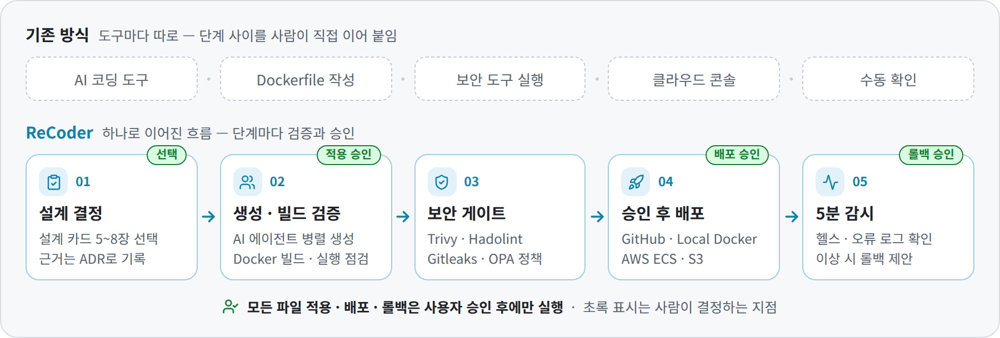
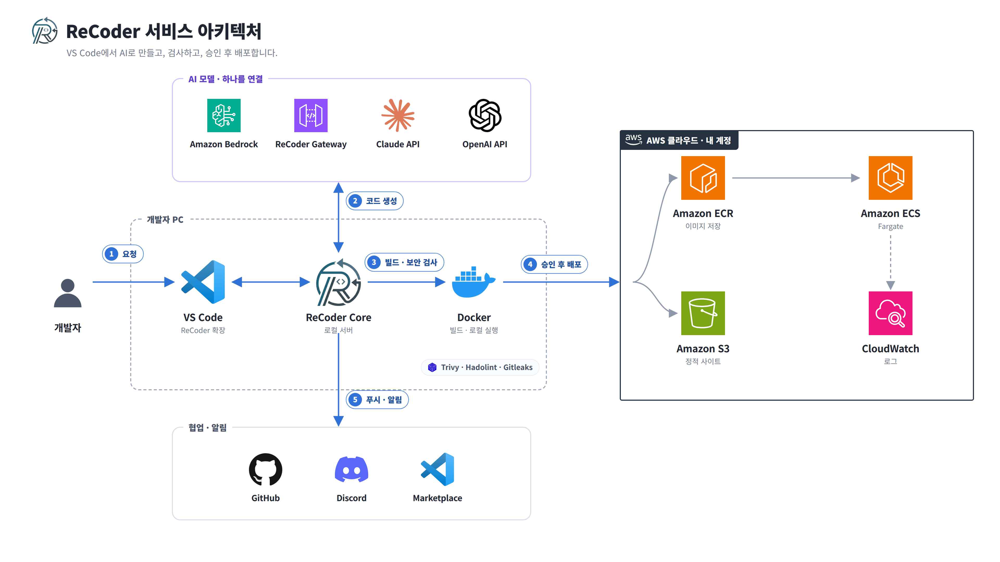
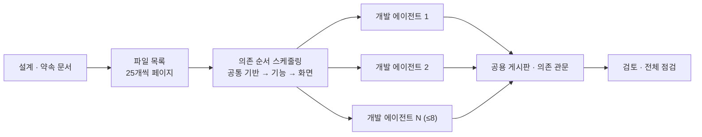
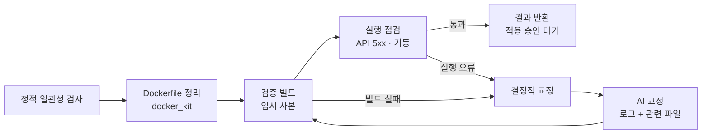

# ReCoder 구현 설계서 v2 (2.0.36 기준)

> **문서 성격** — 2.0.36 코드에 실제로 구현 · 검증된 내용을 기준으로, 이 문서만 보고도 같은 구조를 다시 만들 수 있는 수준으로 기술한다. 각 항목에는 **구현 근거**(왜 이렇게 설계했는가)를 함께 적는다.
>
> **작성 기준일** 2026-10-20 &nbsp;·&nbsp; **대상 브랜치** `feat/2.0.36-dryrun-zerotrust-ai-routing` (커밋 `bdd79f8`, 제품 버전 2.0.36)
>
> **표기** 🟢 구현 · 검증 완료 &nbsp;/&nbsp; 🟡 구현됨(선택 구성 · 실제 AWS 미확인 · 부분) &nbsp;/&nbsp; ⚪ 계획
>
> **관련 문서** [구현 설계서 v1 (1학기 MVP)](ReCoder_구현설계서_v1.md) · [설계 확정서 (ADR 20)](ReCoder_설계_확정서_ADR.md) · [API 명세](API_v10.md) · [검증 범위](production-readiness.md) · [문서 근거 수정](document-grounded-repair.md)

---

## 목차

0. [한눈에 보기](#0-한눈에-보기)
1. [제품 개요](#1-제품-개요)
2. [시스템 아키텍처](#2-시스템-아키텍처)
3. [컴포넌트 상세](#3-컴포넌트-상세)
4. [핵심 파이프라인](#4-핵심-파이프라인)
5. [API · 데이터 계약](#5-api--데이터-계약)
6. [보안 설계](#6-보안-설계)
7. [비용 · 쿼터](#7-비용--쿼터)
8. [빌드 · 릴리스 · 운영](#8-빌드--릴리스--운영)
9. [검증 결과](#9-검증-결과)
10. [구현 현황 · 한계](#10-구현-현황--한계)
- [부록 A. 환경변수](#부록-a-환경변수) · [부록 B. 파일 맵](#부록-b-파일-맵) · [부록 C. 설계 결정 대응표](#부록-c-설계-결정-대응표-d1d20) · [부록 D. 버전 이력](#부록-d-버전-이력-2019--2036)

---

## 0. 한눈에 보기

ReCoder는 VS Code 확장으로 동작하는 **AI DevOps 에이전트**다. 자연어 요청 하나를 **설계 결정(AI-DLC) → 병렬 코드 생성(AI Village) → 빌드·실행 검증 → 보안 게이트 → 승인 후 배포 → 배포 후 감시·롤백 제안**까지 하나의 흐름으로 잇는다.

| 컴포넌트 | 한 줄 정의 | 런타임 | 상태 |
|---|---|---|---|
| **VS Code 확장** | Develop · Deploy · Security 화면, 승인 카드, 배포 캔버스, Core 자동 실행 | 사용자 VS Code | 🟢 |
| **Local Core** | 생성 · 검증 · 보안 검사 · 배포 오케스트레이션 (FastAPI 라우터 22개) | 사용자 PC `127.0.0.1` | 🟢 |
| **AI 모델 계층** | Bedrock · Gateway · Claude/OpenAI(호환) API · Gemini 연결, 작업 등급별 공급자, 비용 원장 | Core 내부 | 🟢 |
| **보안 게이트** | Trivy · Hadolint · Gitleaks + OPA 판정, 수정안 · 재검사, AI 코드 보안 점수, 패키지 신뢰 판정 | Core + Docker | 🟢 |
| **배포 경로** | GitHub · Local Docker · AWS ECS Fargate · S3 정적 | 사용자 PC · 사용자 AWS | 🟢 (ECS 선택 보호 기능 🟡) |
| **ReCoder Gateway** | 운영자 계정에서 AI 호출을 대행 — 학생은 AWS 키 없이 사용 | AWS Lambda (SAM) | 🟢 |
| **Discord 봇** | ChatOps · 알림 · VS Code 연결 | 상시 프로세스 | 🟢 선택 |
| **Watchdog** | EC2 · ECS 상시 감시 데몬 | EC2 (systemd) | 🟡 선택 |
| **Control Plane** | 조직 · 정책 번들 · 다중 승인 · 해시 체인 감사 | FastAPI + PostgreSQL | 🟡 선택 |

**설계 대전제 (구현 근거)**

1. **사람이 결정한다** (D6 · D17) — 설계 선택, 파일 적용, 배포, 롤백은 사용자가 승인한 것만 실행한다. AI가 만든 코드는 변경 목록(ops)으로만 돌아오고, 파일 쓰기는 승인 뒤 확장이 한다. Core가 워크스페이스에 생성 코드를 직접 쓰지 않는 것이 이 프로젝트의 신뢰 모델이다.
2. **결정적 규칙이 먼저, AI는 나중** — 같은 입력이면 같은 결과가 나오는 규칙 교정을 먼저 적용하고, 남은 빌드 · 실행 오류만 로그와 함께 AI에게 넘긴다. AI 호출 비용과 결과의 흔들림을 줄이기 위해서다.
3. **검사하지 못하면 통과도 없다** (fail-closed) — 스캐너를 실행하지 못했거나 결과를 읽지 못하면 "확인하지 못함"으로 남기고 배포를 막는다.
4. **전부 사용자 소유** (D9 · D11) — 배포는 사용자 본인의 AWS 계정으로, 키는 VS Code SecretStorage(OS 보안 저장소)에 둔다. Core는 `127.0.0.1`에서만 열린다.

### v1 대비 변경 요약

| 영역 | v1 (1학기 MVP, 2026-05-30) | v2 (2.0.36, 2026-10-20) |
|---|---|---|
| 생성 | 자연어 → 단일 HTML/JS 정적 결과물 | 설계 카드(새 앱 5\~8장) → 대규모 병렬 생성(개발 에이전트 1\~8) → 빌드 · 실행 검증 → 교정 루프 |
| AI 연결 | 운영자 게이트웨이(Bedrock) 중심 | Bedrock · Gateway · Claude API · OpenAI API · OpenAI 호환 API, 작업 등급(품질 · 절약)별 공급자 |
| 배포 | 운영자 버킷 S3 정적 배포 | Local Docker · ECS Fargate · 사용자 계정 S3(BYO) · GitHub, Drag & Drop 배포 캔버스 |
| 보안 | 정규식 시크릿 스캐너 | Trivy · Hadolint · Gitleaks + OPA 게이트, 수정안 · 재검사, AI 코드 보안 점수, 슬롭스쿼팅 방어, 에이전트 자체 보안 |
| 운영 | 구현됐으나 데모 경로 밖 | 5분 지속 검증 · 롤백 제안, 공격 · 장애 알림, 배포 후 취약점 재검사, AWS 리소스 정리 |
| 검증 | 수동 데모 | CI 3개 OS, 쇼핑몰 통합 50개, 실제 AWS 36개, RAG 비교 실험 144회 |

---

## 1. 제품 개요

### 1.1 문제와 목적

- AI 코딩 도구로 코드 작성은 쉬워졌지만, 생성 이후의 **검증 · 보안 · 배포 · 운영**은 사람이 도구(Dockerfile 작성, 보안 도구, 클라우드 콘솔, 수동 확인)를 하나씩 이어 붙여야 한다. 연결 지점마다 설정 실수와 점검 누락이 생긴다.
- 목적: 생성 이후 단계를 VS Code 안의 한 흐름으로 묶고, 단계마다 **자동 검증과 사람의 승인**을 넣는다.
- 대상: AI로 앱을 만들었지만 Docker · AWS 배포와 보안 확인에서 막히는 학생 · 1인 개발자.

### 1.2 2학기 구현 범위

| 축 | 내용 |
|---|---|
| 개발 | AI-DLC 설계 결정 → ADR 기록, 대규모 병렬 생성(AI Village), 결정적 교정 → 검증 빌드 → 실행 점검 → AI 교정, 구조 지도 · 흐름 dry run |
| 보안 | 보안 게이트(Trivy · Hadolint · Gitleaks + OPA), 결정적 수정안, AI 코드 보안 점수, 패키지 신뢰 판정, Dockerfile 안전 검사, 제로 트러스트 점검 |
| 배포 · 운영 | 배포 캔버스, Local Docker · ECS Fargate · S3 · GitHub, 5분 지속 검증과 롤백 제안, ECS 방패 · HTTPS · 관리형 DB(선택), 공격 · 장애 알림, 취약점 재검사, 리소스 정리 |
| AI 운영 | 공급자 다중화, 작업 등급별 공급자, 비용 원장, 공급자 비교, 문서 근거 수정(RAG) 실험 |

### 1.3 사용자 흐름

<picture>
  <source media="(prefers-color-scheme: dark)" srcset="images/readme/flow-dark.png">
  
</picture>

1. **요청** — 채팅에 만들고 싶은 것을 적는다.
2. **설계 결정** — 결정 카드에서 선택지를 고른다(사람 결정 ①). 선택은 ADR로 남는다.
3. **생성 · 검증** — AI 에이전트가 파일을 나눠 만들고, Core가 검증 빌드 · 실행 점검 · 교정을 마친 결과를 돌려준다.
4. **적용** — 변경 내용(diff)과 보안 점수를 확인하고 적용한다(사람 결정 ②).
5. **배포** — 배포 캔버스에서 대상과 설정을 고르고, 보안 게이트를 통과한 뒤 승인한다(사람 결정 ③).
6. **감시** — 배포 직후 5분 동안 상태를 본다. 이상이 있으면 롤백 제안을 승인한다(사람 결정 ④).

---

## 2. 시스템 아키텍처

### 2.1 전체 구조



| 연결 | 방식 | 내용 |
|---|---|---|
| 확장 ↔ Core | REST · SSE, `X-Session-Token` | 요청 · 진행 이벤트 · 승인 결과, Core는 `127.0.0.1:17894~17910` |
| Core → Docker | docker CLI | 검증 빌드, 실행 점검, 로컬 배포, 보안 도구(바이너리가 없을 때) 실행 |
| Core → AI 모델 | HTTPS | Bedrock · ReCoder Gateway · Claude API · OpenAI(호환) API 중 하나, 작업 등급별 공급자 |
| Core → 사용자 AWS | boto3 (사용자 자격 증명 · 역할) | ECR 업로드, ECS 태스크 정의 · 서비스, S3, CloudWatch, (선택) ALB · WAF · CloudFront · RDS |
| Core → GitHub | GitHub API · git | 저장소 · 시크릿 · Actions · 푸시 |
| 확장 ↔ Discord 봇 | WebSocket 7780 · HTTP 8765 | 개발 요청 전달, 알림 · 상태 |
| Watchdog → Discord | webhook | 상시 감시 알림 |
| Core ← Control Plane | HTTP | 조직 정책 번들(Rego) |

### 2.2 사용 경로

| 경로 | 흐름 | 비고 |
|---|---|---|
| **확장 (기본)** | VS Code 확장 → Local Core → AI 모델 · Docker · 사용자 AWS | 서버 운영 불필요 |
| **교육용 Gateway** | 확장 → Core → ReCoder Gateway(운영자 계정 Lambda) → Bedrock | 학생은 반 코드로 토큰 발급, AWS 키 불필요 |
| **ChatOps** | Discord → 봇 → (브리지) → 사용자 VS Code / Core | `/recoder develop` · `deploy` · `rollback` |
| **조직 (선택)** | Core ↔ Control Plane (정책 번들 · 승인 · 감사) | 조직 · 프로젝트 단위 거버넌스 |

### 2.3 프로세스 · 통신 모델

- **Core 기동**: 확장이 필요할 때 Core를 띄운다(lazy spawn). 개발 모드는 `core/main.py`(프로젝트 `.venv` 우선), 배포본은 `extension/bin/recoder-core(.exe)` → PATH → `~/.recoder/bin` 순서로 찾는다.
- **단일 인스턴스**: `~/.recoder/runtime.json`(포트 · 세션 토큰)과 `core.lock`으로 Core를 하나로 유지한다. 포트는 17894부터 17910까지 차례로 시도한다. `runtime.json`이 지워지면 Core가 3초 안에 다시 쓴다.
- **인증**: 모든 요청에 `X-Session-Token` 헤더가 필요하다(`GET /api/health`만 예외). 확장은 401을 받으면 `runtime.json`을 다시 읽어 한 번 재시도한다.
- **Origin 검사**: 변경 요청(POST · PUT · PATCH · DELETE)은 Origin이 `vscode-webview://` · `http://127.0.0.1` · `http://localhost`일 때만 받고, `Sec-Fetch-Site`가 cross-site · same-site면 거부한다(CSRF). CORS도 같은 Origin만 허용한다.
- **진행 상황**: 생성 · 배포는 SSE(`text/event-stream`)로 단계 이벤트를 보내고 10초마다 heartbeat를 보낸다. 화면 연결이 끊겨도 작업은 취소되지 않는다.
- **쓰기 경계**: AI 결과 파일은 `.git` · `.vscode` 안이나 프로젝트 밖 · 드라이브 경로에 쓰지 않는다(Core와 확장 양쪽에서 차단, 2.0.33).

**구현 근거**: 파일 시스템 · git · docker 같은 로컬 작업은 웹뷰에서 직접 할 수 없으므로 로컬 엔진이 필요하다. Core를 REST로 분리해 확장(TypeScript)과 봇(Python)이 같은 기능을 재사용한다. 로컬 서버는 같은 PC의 다른 웹페이지가 요청을 보낼 수 있으므로 토큰과 Origin 검사를 함께 둔다.

### 2.4 기술 스택

| 영역 | 기술 |
|---|---|
| VS Code 확장 | TypeScript 5.9 · React 18 · Tailwind CSS 4 · three.js 0.160(배포 캔버스) · webpack 5 · VS Code API `^1.85` |
| Local Core | Python 3.11(CI 3.11 · 3.13) · FastAPI · uvicorn · Pydantic 2 · boto3 · PyInstaller(OS별 단일 실행 파일) |
| 보안 | Trivy · Hadolint · Gitleaks · Syft(CycloneDX SBOM) · OPA(Rego) · OSV |
| AI | Bedrock Converse · Anthropic API · OpenAI API · OpenAI 호환 API · Gemini, RAG(BM25 + `multilingual-e5-small` + RRF) |
| AWS | ECS Fargate · ECR · S3 · CloudWatch Logs/Alarms · SNS · ALB · WAF · CloudFront · ACM · Route 53 · RDS PostgreSQL · Secrets Manager · IAM(CloudFormation 빠른 생성) |
| ReCoder Gateway | AWS SAM — API Gateway(HTTP) · Lambda(Python 3.11) · DynamoDB · S3 |
| Discord 봇 | Python · discord.py 2.x · aiohttp |
| Control Plane | FastAPI · SQLAlchemy(async) · PostgreSQL · OPA |
| CI/CD | GitHub Actions (`ci.yml` · `release.yml`) |

---

## 3. 컴포넌트 상세

### 3.1 VS Code 확장 🟢

**역할**: 사용자 진입점. Core를 자동 실행하고, 요청 · 진행 상태 · 승인 화면을 제공하며, 승인된 변경만 워크스페이스에 쓴다.

**화면 구성** (`webview-src/components/Hubs.tsx`)

| 허브 | 기능 카드 | 주요 컴포넌트 |
|---|---|---|
| **Develop** — 요청부터 코드 적용까지 | 코드 생성 · 수정, 에러 분석, 아키텍처(구조 지도 · 흐름 dry run), 설계 기록(ADR), AI 공급자 · 비용 | `ChatPanel` · `CodeAgent` · `DecisionOptionCards` · `TeamVillage` · `TeamBoard` · `CodeMap` · `FlowDryRun` · `FlowPreviewPanel` · `ModelRouting` |
| **Deploy** — 로컬 Docker부터 AWS까지 | 로컬 Docker 배포, 배포 캔버스, 롤백 · Replay, 운영 대응 | `ShipMode` · `canvas/DeploymentCanvas`(three.js) · `DeploySettingsPanel` · `EcsDeploymentProgress` · `EcsProtection` · `TrustCheck` · `OpsAlertsPanel` · `AwsCleanupPanel` · `Replay` |
| **Security** — 배포 전 검사와 정책 | 취약점 스캔, 시크릿 검사, 정책 게이트 | `SecurityScanPanel` · `SecurityFixList` · `ReadinessPanel` · `GroundedRepairPanel` |

**구성 (주요 파일)**

- `src/extension.ts` — 활성화 진입점. 명령 23개 등록, 사이드바 · 워크벤치 뷰 등록.
- `src/core/CoreManager.ts` — Core 탐색 · 기동 · 재시작, `runtime.json`으로 포트 · 토큰 공유.
- `src/core/ApiClient.ts` — Core REST 클라이언트(가변 타임아웃, 401 재시도).
- `src/sidebar/SidebarProvider.ts` — React 웹뷰 메시지 허브(생성 · 적용 · diff · 배포 · 승인).
- `src/ai/aiKeys.ts` — Claude · OpenAI · 호환 API 키를 SecretStorage에만 보관.
- `src/gateway/enroll.ts` — 게이트웨이 반 코드 → 토큰 발급 → SecretStorage 저장.
- `src/discord/DiscordController.ts` — Discord 로그인 연결 · 브리지.
- `src/codemap/` — 구조 지도 · 흐름 dry run 정적 분석(Core · AI 호출 없음).

**명령 (23개 중 주요)**: `Open ReCoder` · `Open Workspace` · `Analyze Error` · `Run Diagnostics` · `Setup Wizard (GitHub + AWS)` · `Connect GitHub` · `Configure AWS Credentials` · `Connect to Gateway (Enroll)` · `Connect AI with API Key` · `절약 등급 AI 공급자 고르기` · `배포할 프로젝트 폴더 변경` · `이 폴더에 코드 생성` · `Start/Restart/Stop Core`.

**핵심 설정 (27개 중 주요)**

| 설정 | 기본값 | 의미 |
|---|---|---|
| `recoder.core.autoStart` · `recoder.core.port` | `true` · `17894` | Core 자동 실행, 기본 포트(17895~17910 폴백) |
| `recoder.llm.provider` · `recoder.llm.region` | `auto` · `us-east-1` | `auto`는 Bedrock 우선 + Gemini 폴백 |
| `recoder.gateway.url` | (빈 값) | 운영자 게이트웨이 주소(교육용) |
| `recoder.ai.anthropicModel` · `openaiModel` | (빈 값) | 비우면 `claude-sonnet-5` · `gpt-5-mini` |
| `recoder.ai.compatibleBaseUrl` · `compatibleModel` | (빈 값) | OpenAI 호환 API 주소(https만, localhost만 http), 비우면 `deepseek-chat` |
| `recoder.ai.economyProvider` · `economyModel` | (빈 값) | 절약 등급 작업의 공급자 · 모델 |
| `recoder.ai.prices` | `{}` | 모델별 100만 토큰당 단가 — 비용 원장 계산 |
| `recoder.bridge.*` · `recoder.discord.*` | — | Discord 봇 브리지(ws 7780) · HTTP API(8765) 연결 |
| `recoder.repair.configPath` | (빈 값) | 문서 근거 수정의 로컬 임베딩 · 문서 설정 |

**구현 근거**

- **확장만 설치하면 동작**: Core 실행 파일을 VSIX에 동봉하고 확장이 자동 기동한다. 실행 파일이 없으면 PATH · 홈 폴더 · 소스 순으로 찾아 개발과 배포를 모두 지원한다.
- **키는 OS 보안 저장소에만** (D11): AI 키 · AWS 키 · 게이트웨이 토큰은 SecretStorage에 두고 설정 파일 · 로그에 쓰지 않는다. AWS 키는 Core가 STS `GetCallerIdentity`로 검증한 뒤에만 저장한다.
- **구조 지도는 확장 안에서**: import · 호출 그래프는 정적 분석으로 만들어 AI · 네트워크 없이 열린다. 큰 저장소에서도 채팅 · 승인이 멈추지 않게 작업 스레드에서 분석한다(2.0.34).

### 3.2 Local Core 🟢

**역할**: 확장 뒤에서 도는 로컬 FastAPI 엔진. 설계 결정, 코드 생성, 검증 빌드, 보안 검사, 배포, 감시를 조율한다.

**라우터 22개** (`core/api/routes/`, 엔드포인트 약 140개)

| 라우터 | 경로 | 역할 |
|---|---|---|
| `health` | `/api/health` · `/api/status` · `/api/diagnostics` · `/api/docker/ensure` | 상태 · 진단 · Docker 기동 |
| `analyze` | `/api/code/plan` · `/api/code/generate(/stream)` · `/api/chat` · `/api/analyze` | 설계 결정 · 코드 생성 · 대화 · 에러 분석 |
| `deploy` | `/api/deploy/*` (preflight · scan · plan · trust-check · settings · readiness · security/fixes · local · execute · rollback · verification) | 배포 준비 · 보안 · 로컬 배포 · 지속 검증 |
| `deploy_ecs` · `ecs` | `/api/deploy/ecs*` · `/api/ecs/*` | ECS 배포 · 상태 · 롤백 · 중지 |
| `deploy_s3` | `/api/deploy/s3(/stream)` | 사용자 계정 S3 정적 배포 |
| `canvas` · `deploy_history` | `/api/deploy/canvas` · `/api/deploy/history` | 배포 캔버스 대상 · 이력 롤백 |
| `aws` · `aws_cleanup` | `/api/aws/*` · `/api/aws/cleanup/*` | 연결 · 역할 · 권한 점검 · 실행 역할 · 리소스 정리 |
| `github` | `/api/github/*` · `/api/git/push` | 토큰 · 저장소 · 시크릿 · Actions 실행 · 푸시 |
| `security_checks` | `/api/security/code` · `/api/security/vulns/*` | AI 코드 보안 점수 · 취약점 재검사 |
| `policy` | `/api/policy/evaluate` · `/api/policy/cache/*` | OPA 평가 · 정책 번들 캐시 |
| `models` | `/api/models/routing` · `/costs` · `/compare` | 작업 등급 라우팅 · 비용 원장 · 공급자 비교 |
| `repair` | `/api/repair/prepare` · `/{run_id}` · `/{run_id}/approve` | 문서 근거 수정(RAG) |
| `ops` · `ops_alerts` | `/api/ops/*` · `/api/ops/alerts/*` | 장애 분석 · 공격 · 장애 알림 대응 |
| `incident` | `/incident/*` | 장애 열기 · 원인 분석 · 사후 보고서 · 해결 |
| `session` | `/api/cost` · `/api/session/*` · `/api/projects` · `/api/project/scan` | 비용 · 세션 기록 · 프로젝트 |
| `workbench` | `/workbench/*` | 워크벤치 상태 · 이벤트 |
| `gitops` · `relay` | `/gitops/*` · `/api/relay/*` | GitOps 동기화 · PC가 꺼졌을 때의 명령 큐(선택) |

**주요 모듈 (기능별)**

| 기능 | 모듈 |
|---|---|
| 설계 결정 · ADR | `code_agent.py`(plan 프롬프트 · 승인 판정) · `adr.py`(정규화 · 번호 예약 · 기록) |
| 대규모 생성 | `gen_engine.py`(LargeGeneration) · `generation_jobs.py`(체크포인트) · `board.py`(공용 게시판) · `payment_kit.py` · `commerce_starter.py` |
| 검증 · 교정 | `generated_validation.py`(검증 빌드) · `runtime_check.py`(실행 점검) · `screen_check.py`(화면 확인) · `build_readiness.py` · `node_fixups.py` · `docker_kit.py` |
| 보안 | `security_scan.py` · `quality_runner.py` · `opa_gate.py` · `security_fix.py` · `code_security.py` · `package_trust.py` · `dockerfile_guard.py` · `trust_check.py` · `sbom.py` · `vuln_recheck.py` · `context_gate.py` |
| 배포 | `local_deploy_agent.py` · `local_services.py` · `deploy_settings.py` · `agents/ecs_agent.py` · `agents/ecs_runtime.py` · `aws_infra.py` · `shield.py` · `aws_edge.py` · `aws_cdn.py` · `aws_rds.py` · `s3_byo.py` · `github_agent.py` |
| 운영 | `cv/monitor.py`(지속 검증) · `rollback_policy.py` · `ops_alerts.py` · `aws_cleanup.py` · `incident_*` · `postmortem_agent.py` · `forecast/` |
| AI | `llm/`(공급자 · 라우터 · 작업 등급 · 비용 원장 · 비밀값 가리기) · `model_compare.py` · `grounded_repair/` |
| 기록 | `persistence/`(SQLite: PreflightRun · RemediationRun · DeploymentLedger) |

**구현 근거**: 한 요청이 설계 · 생성 · 검증 · 배포 모듈을 모두 지나가므로, 각 단계 결과를 같은 Core 프로세스에서 이어받아야 중간 상태(승인한 결정, 생성 결과, 검사 결과)가 어긋나지 않는다. 오래 걸리는 작업은 체크포인트 · 기록 파일로 남겨 화면이 끊겨도 이어 받는다.

### 3.3 AI 모델 계층 🟢

**공급자** (`core/llm/`)

| 공급자 | 파일 | 기본 모델 · 특징 |
|---|---|---|
| Amazon Bedrock | `bedrock_provider.py` | 기본 `global.anthropic.claude-haiku-4-5`, 상위 `claude-sonnet-4-5` (환경변수로 교체) |
| ReCoder Gateway | `gateway_provider.py` | 운영자 계정 대행, 호출당 출력 상한 4,096 토큰 |
| Claude · OpenAI · OpenAI 호환 | `api_key_provider.py` | 키는 SecretStorage → Core 환경변수로만 전달, 호환 API가 강제 도구 호출을 모르면 JSON 모드로 한 번 재시도 |
| Gemini | `gemini_provider.py` | `recoder.llm.provider=auto`일 때 폴백 |

**라우팅** (`provider_router.py` · `router.py` · `breaker.py`)

- 품질 호출(`call_primary`)과 빠른 호출(`call_fast`)을 나누고, 공급자 장애 시 차단기(breaker)와 폴백으로 넘긴다.
- **작업 등급** (`task_tier.py`, 2.0.36): 코드 생성 · 보안 수정 · 교정은 **품질** 등급, 설계 질문 주제 · 요청 요약 · 스캔 요약 · 오류 분류 · 원인 후보 문장 · 테스트 초안은 **절약** 등급. 이름을 모르는 작업은 언제나 품질 등급이다. 절약 공급자가 실패하면 품질 공급자가 이어 받는다.
- **비밀값 가리기** (`scrub.py`): 품질 공급자가 아닌 곳 · OpenAI 호환 API로 나가는 문맥은 키 · 토큰 · `.env` 값 · 접속 문자열 비밀번호를 가린다. 결과가 코드가 되는 작업은 코드가 깨지지 않게 확실한 키만 가린다.
- **Context Gate** (`context_gate.py`): LLM 전송 전 16개 범주의 민감 정보를 가리고, 참고 파일 속 지시형 줄을 걸러 낸다(6.2절).

**비용 원장** (`cost_ledger.py` · `pricing.py`)

- 모든 AI 호출을 등급 · 실제 공급자 · 모델 · 입출력 토큰 · 단가 출처로 `~/.recoder/model_costs.jsonl`에 남긴다. 프롬프트 · 응답 본문은 남기지 않는다.
- 단가를 모르는 모델은 0달러가 아니라 "단가 미설정"으로 표시하고, `recoder.ai.prices`로 계산한다.

**공급자 비교** (`model_compare.py`, `/api/models/compare`): 같은 요청을 실제 생성 경로로 두 공급자에 고정해 돌리고 비용 · 토큰 · 교정 횟수 · 남은 오류 · 보안 점수를 나란히 보여 준다. 파일은 바꾸지 않고, 시작 전에 비용이 두 번 든다는 확인을 받으며, 종합 승자는 정하지 않는다.

**구현 근거**: 학생은 게이트웨이, 개인은 Claude/OpenAI 키, 팀은 Bedrock처럼 사용 환경마다 쓸 수 있는 AI가 다르다. 공급자를 하나로 고정하지 않고 같은 인터페이스 뒤에 두어 교체할 수 있게 했다. 작업 등급은 결과를 사람이 다시 보는 가벼운 작업만 싼 모델로 보내, 코드 품질은 유지하면서 비용을 줄이기 위해 도입했다.

### 3.4 ReCoder Gateway 🟢

**역할**: 운영자 AWS 계정에서 AI 호출과 정적 배포를 대행한다. 사용자는 AWS 키 없이 **본인 토큰**만 가진다(v1 구조 유지).

| 경로 | 인증 | 동작 |
|---|---|---|
| `POST /enroll` | 반 코드 | 자가발급 — 난수 student_id + 토큰(192bit), 정원 · Discord 1:1 제한 |
| `POST /llm/invoke` | Bearer 토큰 | 쿼터 확인 → Bedrock Converse 대행 → 사용량 기록 |
| `POST /verify` | 토큰 | 봇의 `/recoder link`가 바인딩 전에 토큰이 실제 발급된 것인지 확인 |
| `POST /deploy/s3` | Bearer 토큰 | 학생 · 프로젝트 prefix로 정적 파일 업로드 → 공개 URL |
| `POST /admin` | `X-Admin-Key` | 토큰 발급 · 폐기 · 쿼터 조정 · 현황(운영자) |

**기본 파라미터** (`gateway/template.yaml`): 허용 모델 Haiku 4.5(서버 강제) · 사용자별 총 500,000 · 일 100,000 토큰 · 분당 10회 · 토큰 TTL 7일 · 전체 비용 상한 $20(소프트 $18) · Lambda Python 3.11 · 30초.

**구현 근거**: 토큰은 sha256 해시만 저장하고 TTL · 폐기 · 회전을 지원해 유출 피해를 1인 쿼터로 한정한다. 모델 allowlist와 출력 상한을 서버가 강제해 클라이언트가 비싼 모델 · 긴 출력을 임의로 쓰지 못하게 한다. 출력 상한(4,096) 때문에 설계 카드를 3장씩 나눠 동시에 받는 방식(4.1절)을 도입했다.

### 3.5 Discord 봇 🟢 (선택)

- **명령**: `/recoder panel` · `develop` · `link` · `invite` · `preflight` · `status` · `deploy` · `rollback`, 서버 관리자용 `/setup`(API · 알림 채널 · 역할).
- **연결**: Discord OAuth2 로그인(`/api/v1/connect/*`, 기본 `http://127.0.0.1:8765`)으로 사용자와 VS Code를 연결한다. 브리지(WebSocket 7780)로 봇의 개발 요청을 해당 사용자의 VS Code에만 전달한다.
- **보호**: 웹 브라우저가 보낸 요청 · JSON이 아닌 요청 · 키 없이 내 PC 이름이 아닌 Host로 온 요청을 거부한다(CSRF · DNS 리바인딩, 2.0.33).
- **Relay** 🟡: PC가 꺼져 있을 때 들어온 명령을 DynamoDB 큐에 저장하고, PC가 켜지면 Core가 가져가 처리한다(`core/relay/`).

**구현 근거**: 배포 · 롤백 · 상태 확인처럼 짧은 운영 명령은 채팅이 더 빠르다. 실행은 사용자 PC의 Core가 하므로 봇은 키를 갖지 않는다.

### 3.6 Watchdog 🟡 (선택)

EC2에서 systemd 서비스로 도는 독립 감시 데몬(`watchdog/`). Python 표준 라이브러리 + `requests` · `psutil`만 쓰고 docker CLI를 호출한다.

| 감지 | 조건 |
|---|---|
| `container_crash` · `container_oom_killed` · `container_exit_nonzero` | 실행 중이던 컨테이너 중단 · OOM · 0이 아닌 종료 코드 |
| `health_check_failed` | 헬스 체크 URL 3회 연속 실패 |
| `container_memory_high` | 메모리 90% 이상 |
| `ecs_tasks_unhealthy` · `ecs_task_restart_loop` | running < desired 3회 연속 · 관측 창 안 2회 이상 중단 |
| `http_5xx_spike` · `latency_p95_high` | ALB 5xx 비율 5% 초과 · p95 3초 초과 |

감지하면 `incident.jsonl`에 기록하고 Discord webhook으로 알린다. 모든 메시지는 16종 마스킹을 거치며, 60초 안의 같은 fingerprint는 다시 알리지 않는다. ECS · CloudWatch 감시는 클러스터 · 서비스 환경변수를 채웠을 때만 켜진다.

### 3.7 Control Plane 🟡 (선택)

조직 단위 거버넌스 서버(`control_plane/`, FastAPI + PostgreSQL).

| 라우터 | 기능 |
|---|---|
| `/auth` | Google · GitHub OIDC 로그인(비밀번호 인증 없음) |
| `/devices` | 기기 등록 · heartbeat · 폐기 · 토큰 회전 |
| `/orgs` | 조직 · 멤버 · 역할 · 워크스페이스 · 프로젝트 |
| `/policy` | 정책 번들(Rego) 배포 · 평가 |
| `/approvals` | 다중 승인 — 거부 사유 필수, 기본 24시간 만료, 1건이라도 거부 시 반려 |
| `/audit` | 해시 체인 감사 로그 — `event_hash = SHA-256(previous_event_hash + canonical_json(event))`, 무결성 검증 API |

Core의 `policy_cache.py`는 `CONTROL_PLANE_URL`(기본 `http://localhost:18000`)에서 조직 정책 번들을 받아 배포 게이트에 쓴다.

---

## 4. 핵심 파이프라인

### 4.1 AI-DLC 설계 결정 → ADR

1. `POST /api/code/plan` — 코드를 만들기 전에 사람이 정해야 할 **설계 결정**을 선택지로 받는다.
   - **새 앱**: 결정 주제 5~8개를 먼저 받고(기술 → 데이터 → 인증 → 기능 규칙 순서), 주제별 카드를 3개씩 나눠 동시에 받는다.
   - **기존 프로젝트**: 결정 1~3개. 설계 갈림길이 없는 사소한 요청은 확인 카드 하나만 보여 준다.
   - 카드: `question` · 선택지 2~4개(`label` · `summary` · `pros` · `cons` · `recommended`) · `impact`. 선택에 따라 이어서 물을 결정(`followups`)을 끼워 넣는다.
2. 사용자가 고른 결정을 `POST /api/code/generate`에 함께 보낸다. 게이트가 카드 모양(선택지 2~5개, 장단점 5개 이하, 질문 존재)과 승인 상태(`approved` · `cancelled` · `missing` · `invalid`)를 다시 검사한다.
3. `adr.normalize_decisions` 한 곳에서만 결정을 파싱해 **프롬프트와 ADR이 같은 데이터**를 보게 한다. 결정은 `docs/adr/ADR-NNN-slug.md`(결정 · 근거 · 검토한 대안 · 영향)로 생성 코드와 함께 ops에 담긴다.
4. ADR 번호는 예약 장부(스레드 잠금 + OS 파일 잠금)로 발급해, Core가 둘 떠 있어도 같은 번호를 두 번 쓰지 않는다.

**구현 근거**: AI가 코드를 바로 만들면 데이터 저장 방식 · 인증 방식 같은 중요한 선택이 숨은 채 결정된다. 선택지를 먼저 보여 주고 고른 근거를 ADR로 남기면, 사용자가 AI 결과를 검토하는 기준이 생긴다(D3 · D4 · D6). 학생용 게이트웨이의 출력 한도(4,096 토큰) 안에서 카드 5~8장을 받기 위해 주제 → 카드 두 단계로 나눴다.

### 4.2 대규모 생성 (LargeGeneration · AI Village)



- **설계**: 요청과 승인한 결정으로 약속 문서(manifest)와 파일 목록을 받는다. 목록은 응답 한도 안에 확실히 들어가도록 25개씩 페이지로 받고, 빈 목록 · 잘린 응답은 다시 묻거나 들어 있는 경로를 건진다(2.0.19).
- **스케줄링**: 개발 에이전트 N명(1~8, 기본 3, 팀 모드에서는 개발 역할 수)이 의존 순서대로 동시에 작성한다. 파일마다 시작 시점까지 완성된 파일(특히 그 파일이 불러오는 파일)의 실제 내용을 보고 쓴다. 작은 파일은 같은 쪽 · 같은 단계끼리 둘씩 묶어 호출 수를 줄인다.
- **공용 게시판** (`board.py`, 2.0.24): 서버 라우트 파일이 완성되면 실제 경로 · 응답 키 · 로그인 필요 여부를 코드에서 뽑아(AI 호출 없음) 화면 쪽 API 호출 파일에 전달한다. 응답 모양을 읽지 못한 API는 "모양 모름"으로 두고 약속 문서를 따르게 한다.
- **의존 관문** (2.0.24): 파일 하나가 끝날 때마다 그 파일과 그것을 불러오는 완성 파일 사이의 어긋남(내보내지 않은 이름 · 없는 타입)을 검사한다. 기계적으로 고칠 수 있으면 즉시 고치고, 아니면 그 문제만 담아 작성한 에이전트에게 한 번 돌려보낸다. 너무 느린 큰 프로젝트에서는 자동으로 끈다(`RECODER_GATE=0`).
- **실패 처리**: 한 파일은 이번 실행에서 최대 3번 시도하고, 넘으면 그 파일만 실패로 두고 나머지를 계속 만든다. AI가 끝내 쓰지 못한 문서 파일은 설계에서 기본 문서를 자동 작성한다.
- **속도 · 안정**: 게이트웨이 모드는 분당 9회로 미리 제한하고(`RECODER_LLM_RPM`), 일시적 오류는 3 · 8 · 20 · 45 · 60초 간격으로 재시도한다. 일일 · 총량 한도에 걸리면 일시 정지한다.
- **체크포인트**: 진행 상태를 `~/.recoder/generation/<job>.json`에 저장한다. 요청문 · 승인한 결정 · 대상 폴더 · 프로젝트가 같을 때만 이어 쓰며, 완료된 작업은 결과를 바로 돌려준다.
- **고정 모듈**: 결제가 들어간 앱은 Stripe 결제 모듈(`payment_kit`, 모의 결제 모드 · 서명 웹훅)을 고정 파일로 넣고 AI는 불러 쓰기만 한다. 쇼핑몰 요청에는 검증된 시작 템플릿(`commerce-v1`)을 선택지로 제시한다.

**구현 근거**: 한 번의 응답으로 수십 개 파일을 받으면 출력 한도에 걸려 잘린다. 파일 단위로 나누되 서로 의존하는 파일은 순서를 지키게 해, 동시 작성의 속도와 파일 간 일관성을 함께 얻는다. 화면과 서버가 서로 다른 API 모양으로 만들어지던 실기기 문제(`{ orders }` vs `data.items`)를 사후 검사 대신 작성 시점에 막기 위해 게시판을 도입했다.

### 4.3 검증 · 교정 루프



| 단계 | 내용 |
|---|---|
| 정적 일관성 검사 | 없는 로컬 import, 서버가 등록하지 않은 API 파일, 결제 약속 누락, Dockerfile 안전 검사, AI 코드 보안 점수의 확실한 발견을 고칠 오류로 넣음 |
| 검증 빌드 | `generated_validation.py` — 비밀값을 걸러 낸 **임시 사본**에서 Docker 빌드(기본 480초). 원본 프로젝트는 건드리지 않음 |
| 실행 점검 | `runtime_check.py` — 빌드한 이미지를 ECS staging과 같은 구성(DB · 모의 결제 · 시드)으로 잠깐 띄워 사용자 흐름의 API를 호출, 5xx · 기동 실패를 서버 로그와 함께 수집 |
| 결정적 교정 | `node_fixups` · `build_readiness`(Node · npm · Dockerfile · Python 규칙) · Prisma 관계 이름 맞춤 등 AI 없이 고칠 수 있는 것부터 수정 |
| AI 교정 | 빌드 로그 · 실행 오류를 파일별 문제로 바꿔 해당 파일만 고치게 함 |
| 종료 조건 | 최대 6회 · 시간 예산 540초. 오류 집합이 줄지 않으면 멈추고, 이번 교정이 오류를 더했으면 **직전 상태로 되돌림** |

**구현 근거**: 빌드 검증은 "컴파일된다"까지만 본다. 실기기 생성 결과는 빌드를 통과했지만 상품 목록 SQL 번호 어긋남으로 500, 주문 함수 인자 누락으로 401이 났다(2.0.16). 실행 점검이 이런 오류를 배포 전에 잡는다. 교정이 같은 오류를 되풀이하던 문제("계속 고치기만 한다", 2.0.7)는 오류 집합 비교와 되돌리기로 막았다.

### 4.4 보안 게이트

**검사 도구**

| 도구 | 대상 | 실행 |
|---|---|---|
| Trivy | 이미지 · 의존성 취약점 | 바이너리 → 없으면 공식 Docker 이미지 → 둘 다 없으면 `trivy_not_installed`로 차단 |
| Hadolint | Dockerfile | 같은 방식 |
| Gitleaks + 내장 스캐너 | 소스 속 비밀값(결제 · AI · 메일 · 패키지 서비스 키 패턴 포함) | 같은 방식, 값은 항상 가려서 표시 |
| Syft | SBOM(CycloneDX JSON) | 바이너리 → Docker 이미지 |

**정책 판정** (`policies/recoder/deploy.rego`, 기본 거부 · 승인 레벨 3)

| 규칙 | 차단 조건 |
|---|---|
| 1 | SBOM이 없음 |
| 2 | Trivy critical 1건 이상 |
| 3 | Gitleaks가 비밀값 발견 |
| 4 | Hadolint error 수준 발견 |
| 5 | production 배포가 허용 브랜치(`main`) 밖이거나 브랜치 정보가 없음 |

결과는 `decision` · `reason` · `fix_suggestion` · `approval_level` · `policy_bundle_version` 객체로 돌려준다. OPA 서버(`OPA_URL`, 기본 `localhost:8181`)가 없으면 Core의 `_local_deploy_gate`가 같은 규칙을 적용하며, 두 구현은 함께 고치고 `deploy_test.rego`로 검증한다.

**승인 레벨** (`schemas.ApprovalLevel`): `AUTO(1)` 자동 · `CONFIRM(2)` 확인 · `DOUBLE_CONFIRM(3)` 이중 확인 · `BLOCKED(4)` 실행 불가. 위험도는 `low` · `medium` · `high` · `critical`.

**결정적 수정안** (`security_fix.py`): 발견 항목마다 결정적으로 고칠 수 있는지 판단해 수정안을 만들고, 사용자가 고른 것만 적용한다. 원본은 `.recoder/backups/`에 남기고 적용 뒤 재검사한다. AI를 쓰지 않으므로 같은 입력이면 같은 수정이 나온다.

**AI 코드 보안 점수** (`code_security.py`, 2.0.28): AI를 부르지 않고 정규식 · 구조 분석으로 9가지를 점검한다 — SQL 인젝션, 로그인 확인이 빠진 변경 API, 남의 데이터를 고칠 수 있는 API, 위험한 JWT 설정, 비밀번호 평문 저장, 쿠키 허용 + 전체 Origin 허용 CORS, HTML 그대로 넣기(XSS), 로그인 무차별 대입, 오류 내부 정보 노출. 정확도가 확인된 규칙의 심각한 발견은 생성 교정 루프에 오류로 넣고, 나머지는 위치 · 고치는 법과 함께 경고로 보여 준다. 쇼핑몰 기반(`commerce-v1`)은 100점 기준선이다.

**패키지 신뢰 판정** (`package_trust.py`, 2.0.23)

- 유명 npm 패키지 17,817개 목록 기준으로 **한 글자 차이** 이름(예: `exprees-validator`)은 원래 패키지로 자동 교체한다.
- 처음 올라온 지 30일 미만이고 지난주 다운로드가 1,000회 미만인 무명 패키지는 막고 AI 교정에 "검증된 패키지로 바꾸라"고 넘긴다. 설치 스크립트가 있거나 저장소 정보가 없는 패키지는 경고만 한다.
- 판정은 하루 동안 캐시한다. 사내 레지스트리 · 오프라인 환경에서는 검사하지 않고, 사내 스코프는 `RECODER_TRUSTED_SCOPES`로 뺀다.

**Dockerfile 안전 검사** (`dockerfile_guard.py`, 2.0.29~2.0.33): 내려받은 스크립트를 확인 없이 실행(`curl … | sh` 류, 공식 설치 주소 예외), 빌드 격리 해제, 호스트 Docker 소켓 · 시스템 경로 접근, 비밀 파일 읽기 · 비밀값 외부 전송을 **빌드 전에** 막는다. 체크섬 · 서명을 확인한 내려받기, BuildKit 비밀 마운트 같은 올바른 방법은 허용한다.

**제로 트러스트 점검** (`trust_check.py`, 2.0.35): 로컬 · ECS · S3 승인 화면에서 기존 보안 장치를 다섯 원칙(AI 결과를 그대로 믿지 않는다 · 최소 권한 · 네트워크를 믿지 않는다 · 비밀값은 코드와 이미지 밖에 · 기록하고 되돌릴 수 있게)으로 묶어 통과 · 주의 · 막힘으로 보여 준다. 새로 배포를 막지는 않는다(막힘은 이미 배포를 막는 검사의 결과).

**구현 근거**: 보안 도구는 많지만 따로 실행하면 배포할 때마다 빠뜨린다(D15 · D16). 배포 흐름 안에 검사를 넣고, 막을 때는 이유와 고치는 법을 함께 준다. 차단 사유는 정책의 일부이므로 OPA 결과를 boolean이 아닌 객체로 돌려준다. 같은 PC에서 경로에 따라 스캐너 유무가 달라 ECS 배포만 "미설치"로 막히던 실기기 문제를 Docker 이미지 폴백으로 해결했다.

### 4.5 배포

#### 4.5.1 배포 캔버스

프로젝트 노드를 GitHub · Docker · ECS · S3 대상 위로 끌어 놓으면 설정 서랍이 열리고, 설정 확인 → 보안 게이트 → 승인 카드를 거쳐 실행한다. **놓기만으로는 배포되지 않는다.** 캔버스는 three.js 3D 장면으로 그리며, 보안 게이트 노드가 검사 상태(대기 · 차단 · 통과)를 색으로 보여 준다.

#### 4.5.2 Local Docker 🟢

| 단계 | 내용 |
|---|---|
| 준비 | Dockerfile 생성 · 검사, 필요한 설정값 탐지(`deploy_settings.py`, `~/.recoder/deploy_settings/<container>.json`, 0600) |
| 보조 서비스 | 앱이 쓰는 DB(PostgreSQL · MongoDB · Redis)를 같은 Docker 네트워크 컨테이너로 함께 띄움, 결제 키가 없으면 모의 결제 서버 |
| 실행 | `docker build` → `run` → Health Check(3회, 5초 간격). **통과한 뒤에만 기존 컨테이너 교체**, 실패하면 이전 컨테이너 유지 |
| 데이터 | 이미지가 데이터 폴더(VOLUME)를 선언하면 앱 전용 볼륨을 붙여 재배포 · 되돌리기에도 유지(2.0.33) |
| 노출 | 기본으로 이 PC에서만 열림(`RECODER_LOCAL_BIND=127.0.0.1`) |
| 확인 | 화면 확인(`screen_check.py`) — 헬스 경로가 200이어도 화면이 비어 있는 배포를 잡음 |

#### 4.5.3 AWS ECS Fargate 🟢

**진행 단계 11개** (`agents/ecs_progress.py`)

| # | 키 | 표시 | 생략 조건 |
|:---:|---|---|---|
| 1 | `preflight` | 사전 점검 | — |
| 2 | `provisioning` | 인프라 확인 · 준비 | — |
| 3 | `source_scan` | 소스 · Dockerfile 검사 | 보안 검사 끔 |
| 4 | `building` | 이미지 빌드 | 워크스페이스 없음 |
| 5 | `ecr_push` | ECR 업로드 | 워크스페이스 없음 |
| 6 | `image_scan` | 이미지 취약점 검사 | 보안 검사 끔 |
| 7 | `sbom` | SBOM 생성 | SBOM 끔 |
| 8 | `task_def` | 태스크 정의 등록 | — |
| 9 | `svc_update` | 서비스 갱신 | — |
| 10 | `stabilizing` | 서비스 안정화 · 헬스체크 | 원하는 태스크 수 0 |
| 11 | `url_check` | 공개 주소 확인 | 원하는 태스크 수 0 · 대기 시간 0 |

- **실행 설정** (`agents/ecs_runtime.py`): staging은 로컬 배포와 같은 것을 **같은 태스크 안 보조 컨테이너**로 준비한다 — DB(ECR Public 공식 이미지, 127.0.0.1에서만 대기, 초기화 SQL), 앱 서명 키(서비스마다 한 번 생성해 PC에 0600 보관), 모의 결제 서버, 샘플 데이터. production은 임시 DB · 평문 키 · 모의 결제를 쓰지 않고, 비어 있는 값은 Secrets Manager ARN으로 넣으라고 **AWS 자원을 만들기 전에** 막는다.
- **헬스 경로**: 이미지와 선언된 라우트(`app.use('/health', …)` 등)에서 찾아 ECS 헬스체크를 켠다. 실패하면 멈춘 태스크의 이유 · 종료 코드 · 앱 로그 끝부분을 결과에 보여 준다(2.0.21).
- **권한**: 최소권한 정책(`aws_policy.py`)을 CloudFormation 빠른 생성 템플릿(`infra/recoder-iam-quickcreate.json`)으로 제공하고, 실행 역할은 미리 보기 → 승인 후 생성한다. 정책은 AWS 크기 한도 안에서 여러 개로 나눈다.
- **태그**: 새로 만드는 클러스터 · 서비스 · 태스크 정의 · ECR · 로그 그룹 · 보안 그룹 · S3에 `recoder:managed=true`를 붙인다(이미 있던 리소스는 건드리지 않음).

**선택 보호 기능** 🟡 (실제 AWS 동작 미확인 — 10장)

| 기능 | 내용 |
|---|---|
| 기본 방패 (2.0.25) | 태스크 안 nginx(`recoder-shield`)가 IP당 초당 요청을 제한(느슨 50 · 보통 20 · 엄격 5), 초과는 429. 앱이 `PORT` 환경변수를 읽을 때만 켬 |
| 대규모 방패 (2.0.26) | ALB + AWS WAF — IP당 5분 2,000회 기본 제한, AWS 관리 규칙 2개. 비용 확인(대략 월 25달러 이상) 후에만 생성 |
| HTTPS 주소 (2.0.27 · 2.0.35) | ALB 앞 CloudFront(`https://*.cloudfront.net`), 내 도메인 · ACM 인증서 · Route 53 자동 레코드, 원본 잠금 머리글, CloudFront → ALB 구간 HTTPS |
| 관리형 DB (2.0.27) | RDS PostgreSQL(db.t4g.micro · 20GB gp3 · 암호화 · 자동 백업 · 삭제 보호 · 비공개), 접속 정보는 Secrets Manager. 비용 확인(대략 월 15달러 이상) 후에만 생성 |

#### 4.5.4 S3 정적 배포 (BYO) 🟢

정적 사이트 빌드 결과를 **사용자 계정 버킷**에 올린다(`s3_byo.py`, D9). 1학기의 운영자 버킷 방식(게이트웨이 `/deploy/s3`)은 교육용 경로로 남겨 두었다.

#### 4.5.5 GitHub 🟢

VS Code 인증 세션(`vscode.authentication.getSession('github')`)으로 받은 토큰을 Core에 전달한다. 저장소 생성 · 연결, Actions 시크릿, 워크플로 생성, 보안 검사 후 푸시를 제공한다. 이미 내용이 있는 저장소 · 공개 범위가 다른 저장소에는 올리지 않고, 다른 곳을 가리키는 origin과 로컬 브랜치 이름은 바꾸지 않는다(2.0.33).

**구현 근거**: 배포 대상마다 필요한 준비물(DB · 키 · 결제 · 헬스 경로)이 달라 "배포는 됐는데 앱이 바로 죽는" 상태가 반복됐다. 로컬과 ECS staging이 같은 준비 과정을 공유하게 하고, production은 평문 값을 쓰지 않도록 AWS 자원을 만들기 전에 막는다. 비용이 계속 나오는 리소스(ALB · WAF · RDS)는 명시적 확인 없이는 만들지 않는다(D14).

### 4.6 배포 후 감시 · 롤백

- **지속 검증** (`cv/monitor.py`): 배포 직후 기본 300초 동안 30초 간격으로 헬스 실패 · 분당 오류 로그 · 메모리 사용률을 모은다. 트리거가 하나라도 발동하면 결과 상태를 `AUTO_ROLLBACK_PROPOSED`로 두고 롤백 대상을 정한다. **실행은 사용자가 승인한 뒤에만** 한다(D17). 5분 감시를 통과한 배포만 다음 롤백 후보가 된다.
- **롤백 범위**: 코드(백업 복원, `rollback_policy.py`) · 로컬 컨테이너(이전 이미지 재실행) · ECS(이전 태스크 정의 리비전, `/api/deploy/ecs/rollback`). 배포 이력 화면에서도 대상을 골라 승인 후 되돌린다.
- **공격 · 장애 감지 알림** (`ops_alerts.py`, ECS): 방패 접속 기록 → CloudWatch 지표 필터(Requests · Blocked · Errors)와 실행 태스크 수를 1분마다 본다. 요청이 평소의 10배, 차단 20% 초과, 오류 5% 초과, 태스크 3회 연속 부족이면 VS Code · Discord로 알리고(5분 50건 미만이면 비율 알림 생략), "IP 막기 · 방패 엄격 · 태스크 늘리기 · 이전 버전" 제안을 승인 카드로 붙인다. 알림 메일은 SNS로 보내 PC가 꺼져 있어도 받는다.
- **배포 후 취약점 재검사** (`vuln_recheck.py`, 2.0.28): Core가 켜져 있는 동안 하루 한 번 배포 때 만든 SBOM을 OSV와 대조해 **배포 이후 새로 발표된** 취약점만 알린다. 패키지 이름 · 버전만 보낸다. 고쳐진 버전이 있으면 올리기 제안을 붙이고, 승인하면 `package.json`(직접 쓰지 않는 패키지는 `overrides`) · `requirements.txt`만 바꾼다. 다시 배포는 사용자가 한다.
- **AWS 리소스 정리** (`aws_cleanup.py`, 2.0.26): `recoder:managed=true` 태그가 있는 리소스만 서비스별로 보여 준다. "중지"는 태스크 수를 0으로, "완전 삭제"는 항목 체크 + 승인 카드 후 의존 순서(서비스 → WAF → 로드밸런서 → … → 빈 클러스터)로 지운다. 지울 때도 목록을 다시 만들어 태그를 재확인하고, 태그가 없는 옛 리소스는 "수동 확인 필요"로만 표시한다.
- **장애 기록**: `/incident` API로 장애를 열고 원인 분석 · 사후 보고서를 만든다. 같은 fingerprint의 장애가 다시 나면 과거에 성공한 수정을 다시 제안한다(`incident_memory`, LLM 호출 없음).

### 4.7 흐름 dry run (2.0.34) 🟢

구조 지도에서 API 경로(Express · Fastify · Next.js · FastAPI · Flask), 화면 동작(`onClick` · `addEventListener`), 실행 파일 중 하나를 고르면 그 요청이 지나가는 함수를 호출 순서대로 한 단계씩 재생한다.

- 경로에 걸린 미들웨어(`app.use('/api', requireAuth, router)`) · FastAPI `Depends(…)`를 핸들러보다 먼저 보여 주고, `app.use` · `include_router` · `APIRouter(prefix=)` 접두사를 합쳐 실제 주소로 표시한다.
- 함수마다 DB(SQL · ORM) · 외부 API · 결제 · AWS · 비밀값(환경변수) · 파일 쓰기 · 명령 실행을 표시한다.
- **적용 전 흐름 미리 보기**: AI 생성 결과를 파일에 쓰지 않고 바뀔 내용으로 흐름을 다시 그려, 새로 생기거나 바뀌는 함수와 그 변경이 지나가는 경로, 보안 점수 발견 위치를 보여 준다.

**구현 근거**: diff만으로는 변경이 어떤 요청 경로에 영향을 주는지 알기 어렵다. 실행하지 않고 호출 경로를 보여 주면 사용자가 AI 결과를 승인하기 전에 영향 범위를 확인할 수 있다.

### 4.8 문서 근거 수정 (RAG) 🟢

배포 중 빌드 · ECS 오류가 나면 규칙 점검 → 공식 문서 검색 → 근거 포함 수정안 → 복사본 재검증 → 사용자 승인 순서로 처리한다(`core/grounded_repair/`, `/api/repair/*`).

- **색인**: 직접 작성 요약 10개 + 라이선스를 검토한 공식 문서 원문 148개 = 158개 단락.
- **검색**: BM25와 `intfloat/multilingual-e5-small`(고정 revision, CPU 로컬 임베딩) 코사인 검색을 RRF로 합치고, 정확한 오류 코드를 먼저 보장한다.
- **수정안**: 파일 diff와 출처 단락을 함께 제시하고, 각 파일 편집에 하나 이상의 직접 근거를 요구한다.
- **승인**: 복사본에서 재검증을 통과한 뒤 사용자가 승인한다. ECS · IAM · S3 환경 오류는 빌드 통과만으로 승인하지 않고 수동 확인으로 남기며, 재배포는 별도 승인이다.
- **문서 갱신**: 고객 계정의 private · versioned S3와 Lambda(`infra/repair-documents.yaml`)로 승인된 저장소의 원문을 갱신한다. 이용 조건이 바뀌거나 다운로드가 실패하면 기존 색인을 유지한다.

실험 결과와 해석은 9.2절에 있다.

---

## 5. API · 데이터 계약

### 5.1 공통 규칙

- 기본 주소 `http://127.0.0.1:<port>` (17894~17910), 헤더 `X-Session-Token: <runtime.json의 토큰>`.
- 변경 요청은 허용 Origin에서만, 응답은 JSON. 오래 걸리는 작업은 `…/stream` 경로가 SSE로 `{"step", "message", …}` 이벤트를 보내고 마지막에 `{"step": "done", "result": …}` 또는 `{"step": "error", …}`를 보낸다.

### 5.2 설계 결정 · 생성

**POST /api/code/plan**

```text
요청  { "instruction", "workspace_path", "target_folder", "context_files": [...],
        "open_file_path", "open_file_content", "after_starter" }
응답  { "decisions": [ { "id": "storage", "question": "데이터를 어디에 저장할까요?",
                         "options": [ { "key", "label", "summary", "pros": [], "cons": [], "recommended": true } ],
                         "impact": "..." } ],
        "followups": { "<decision_id>": { "<option_key>": [ ...이어서 물을 결정... ] | "ai" } } }
```

**POST /api/code/generate** (`/stream`은 같은 결과를 SSE로)

```text
요청  { "instruction", "workspace_path", "target_folder", "context_files", "open_file_path", "open_file_content",
        "decisions": [ { "id", "chosen_key", … } ], "mode": "auto" | "team", "agents": 0~8 (0 = 기본값),
        "resume_job", "skip_failed" }
응답  { "summary", "ops": [ { "action": "create|edit|delete", "file", "language", "content", "rationale", "secret_warnings": [] } ],
        "adr": [ "docs/adr/ADR-NNN-*.md" ], "verification": { "kind": "docker-build", "status", "passed", "runtime" },
        "security": { 점수 · 규칙별 발견 }, "consistency_issues": [], "prompt_guard": [], "skipped_files": [],
        "unused_files": [], "foundation", "model", "provider", "job_id" }
```

### 5.3 배포

- `POST /api/deploy/preflight` · `/scan` · `/readiness` · `/readiness/fix(-all)` · `/security/fixes(/apply)` — 배포 전 점검과 결정적 수정.
- `POST /api/deploy/trust-check` — 제로 트러스트 점검 결과(원칙별 통과 · 주의 · 막힘).
- `POST /api/deploy/local` · `/execute` — 승인된 배포 실행, `GET /api/deploy/verification/{id}/status` — 지속 검증 상태.
- `POST /api/deploy/ecs` → 배포 기록(`progress_steps: [{key, label, status}]`), `GET /api/deploy/ecs/status`, `POST /api/deploy/ecs/rollback`.
- `POST /api/deploy/history/{source}/{deployment_id}/rollback` — 이력 기반 롤백(승인 후).

**OPA 입력 · 출력**

```text
입력  { "sbom": { "present" }, "trivy": { "critical_count" }, "gitleaks": { "passed" },
        "hadolint": { "passed" }, "environment", "branch" }
출력  { "decision": "allow|deny", "reason", "fix_suggestion", "approval_level": 1~4, "policy_bundle_version" }
```

### 5.4 로컬 저장소

| 경로 (`~/.recoder/` 기준) | 내용 |
|---|---|
| `runtime.json` · `core.lock` | Core 포트 · 세션 토큰 · 단일 인스턴스 잠금 |
| `generation/<job>.json` | 대규모 생성 체크포인트 · 완료 결과(0600) |
| `deploy_settings/<container>.json` | 로컬 배포 설정값(0600) |
| `ecs_deployments.json` · `ecs_runtime/` · `local_deployments.json` | ECS · 로컬 배포 기록, 서비스별 서명 키 |
| `model_costs.jsonl` | AI 비용 원장(숫자 · 이름만) |
| `recoder.db` | Preflight · Remediation · DeploymentLedger(append-only) |
| `sbom/` · `cache/` · `postmortems/` · `audit/` | SBOM, 판정 캐시(패키지 신뢰 등), 사후 보고서, 롤백 · 사후 분석 감사 기록 |
| `mcp_calls.jsonl` | MCP 도구 호출 기록(시각 · 도구 · 인자 이름만) |
| 프로젝트 `.recoder/backups/` | 보안 수정 · 교정 전 원본 |
| 프로젝트 `docs/adr/` | 설계 결정 기록 |

### 5.5 브리지 프로토콜 (Discord ↔ VS Code, ws 7780)

봇 → VS Code 이벤트: `{type:"start", filename, language, prompt}` → `{type:"chunk", text}` → `{type:"end", filename, auto_run}` / `{type:"delete", filename}`. 확장은 받은 결과를 바로 실행하지 않고 미리 보기로만 연다(`recoder.bridge.allowAutoRun` 기본 끔).

---

## 6. 보안 설계

### 6.1 위협과 대응

| 위협 | 대응 (구현) |
|---|---|
| 로컬 Core 무단 호출 | `127.0.0.1` 바인딩, 세션 토큰, 변경 요청 Origin · `Sec-Fetch-Site` 검사, CORS 제한 |
| 키 유출 | AI · AWS 키와 토큰은 SecretStorage에만, 로그 · 설정 파일 · 프로세스 인자에 값 미기록, 게이트웨이 토큰은 해시만 저장 |
| AI로 비밀값 유출 | Context Gate 16범주 마스킹, 외부 공급자 문맥 비밀값 가리기, 검증 빌드는 비밀값을 걸러 낸 사본에서 |
| 취약한 이미지 · 비밀값 포함 배포 | Trivy · Gitleaks · Hadolint + OPA 차단, 검사 실패 시 차단(fail-closed) |
| AI가 만든 취약 코드 | AI 코드 보안 점수 9규칙, 확실한 발견은 생성 중 교정 |
| 공급망 공격 · 지어낸 패키지 | 패키지 신뢰 판정(유사 이름 교체 · 무명 신규 패키지 차단), 배포 후 OSV 재검사 |
| 권한 과다 | 최소권한 정책 · `recoder-*` 리소스 · 태그 조건, 루트 키 경고, 정리는 태그 리소스만 |
| 무분별한 실행 | 승인 레벨 4단계, 파일 적용 · 배포 · 롤백 · 리소스 삭제 · 비용 리소스 생성은 승인 후 |
| 감사 추적 손상 | 배포 원장 append-only, Control Plane 해시 체인 감사 로그 |

### 6.2 AI 에이전트 자체의 보안 (OWASP Top 10 for Agentic Applications)

| 위험 | 대응 | 위치 |
|---|---|---|
| ASI01 목표 가로채기 · 숨은 지시 | 첨부 · 참고 · 열린 파일(README · 문서는 전체, 코드는 주석)에서 "이전 지시를 무시하라", "키를 이 주소로 보내라" 같은 줄을 AI 전송 전에 빼고, 파일 내용은 데이터로 표시, 뺀 줄 수와 위치를 결과에 알림 | `context_gate.py` |
| ASI02 · ASI05 도구 오용 · 예상치 못한 코드 실행 | 위험한 Dockerfile RUN을 검증 빌드 · 로컬 배포 · ECS 빌드 전에 차단 | `dockerfile_guard.py` |
| ASI03 권한 남용 | AWS 루트 키 연결 시 빨간 경고와 최소권한 키 안내 | `api/routes/aws.py` · `trust_check.py` |
| ASI06 기억 · 문맥 오염 | 검증을 통과한 교정 기록에 설치별 키로 HMAC 서명, 바뀐 기록은 재사용 · 적용 거부 | `grounded_repair/store.py` |
| ASI07 도구 호출 추적 | MCP 도구 호출을 시각 · 도구 · 인자 이름으로 기록(값 미기록) | `mcp_server.py` |
| ASI09 사람-에이전트 신뢰 악용 | 승인 카드에 실제 실행할 요청 · 위치 · 파일을 보여 주고, AI가 쓴 요약은 "AI 설명"으로 분리 | 확장 승인 카드 |

### 6.3 비밀값 처리 원칙

- 값은 로그 · 기록 · 화면에 남기지 않고 **이름만** 남긴다(ECS 실행 설정, 비용 원장, MCP 기록).
- 컨테이너에 AWS 자격 증명을 넘길 때는 값이 아닌 `-e NAME`으로 넘겨 프로세스 목록에 보이지 않게 한다.
- production 비밀값은 Secrets Manager 참조로만 넣는다. 평문 값이 필요하면 AWS 자원을 만들기 전에 배포를 막는다.

---

## 7. 비용 · 쿼터

| 영역 | 통제 방식 |
|---|---|
| AI 호출 | 작업 등급(절약 공급자는 가벼운 작업만), 비용 원장, 단가 미설정 표시, 공급자 비교(시작 전 비용 확인) |
| 교육용 게이트웨이 | 서버 강제 모델 allowlist, 사용자별 총 · 일 토큰 · 분당 횟수, 전체 비용 상한 $20(소프트 $18), 출력 상한 4,096 |
| AWS 리소스 | ALB · WAF · RDS 등 상시 요금 리소스는 비용 확인 체크 없이는 생성하지 않음, 끄고 재배포하면 남은 리소스 안내, 태그 기반 정리 |
| 실험 | RAG 실험은 호출 전 최악 비용을 예약하는 SQLite 장부로 총 $30 상한 공유(실사용 추정 $5.49) |

---

## 8. 빌드 · 릴리스 · 운영

### 8.1 CI (`.github/workflows/ci.yml`, develop 대상 PR · push)

| 잡 | 내용 |
|---|---|
| `test` | Core pytest — Ubuntu · Windows · macOS(Python 3.11) + Ubuntu(Python 3.13) |
| `golden-path` | 골든패스 스모크(설계 결정 → 생성 → ADR → S3 배포, 픽스처 LLM + moto S3) |
| `webview` | 웹뷰를 Node에서 실제 렌더해 핵심 화면 경로 확인(Ubuntu · Windows) |
| `watchdog` · `discord` | Watchdog pytest, Discord 로그인 · 프로젝트 연결 |
| `commerce` | 쇼핑몰 주문 · 보안 통합 검증(독립 PostgreSQL · 모의 결제) |
| `dependency-audit` | 배포 의존성 보안 검사(npm · 세 플랫폼 Python 잠금 목록) |

### 8.2 릴리스 (`.github/workflows/release.yml`)

`v*` 태그 push → 태그와 제품 버전 일치 확인 → Windows x64 · Linux x64 · macOS ARM64 VSIX 빌드(Core는 PyInstaller 단일 실행 파일로 동봉) → CI 전체 테스트 → sha256 확인 · 빌드 출처 증명(attestation) → GitHub Release. `v2.0.x-rc1` 같은 태그는 시험 릴리스로 표시한다.

### 8.3 운영 런북 (요약)

- **개발 실행**: `core`에서 `pip install -r requirements.txt && python main.py`, `extension`에서 `npm install && npm run build` 후 F5.
- **교육용 게이트웨이**: `aws configure`(운영자) → Bedrock 모델 액세스 → `sam deploy` → 반 코드 공유 → 확장 `recoder.gateway.url` 설정.
- **IAM 빠른 생성 템플릿**: `core/aws_policy.py`가 원본, `scripts/generate_iam_template.py`로 `infra/recoder-iam-quickcreate.json` 재생성(드리프트 테스트로 어긋남 검사).
- **Discord 봇**: `discord-bot/.env` 설정(봇 토큰 · Client ID/Secret · Redirect) → `bash run.sh doctor` → `bash run.sh`.
- **Watchdog**: EC2에서 `watchdog/install.sh`(전용 가상환경 · systemd 서비스).
- **정리**: 운영 화면의 「AWS 리소스 정리」에서 리전 선택 → 중지 또는 완전 삭제.

자세한 절차는 [SETUP.md](../SETUP.md)와 [release-runbook.md](release-runbook.md)를 따른다.

---

## 9. 검증 결과

### 9.1 제품 검증

| 대상 | 결과 | 기준 |
|---|---|---|
| 테스트 | Core 2,831 · 확장 화면 574 · Watchdog 65 · Discord 112 통과, 골든패스 · 의존성 감사 통과 | 2.0.30 |
| CI | Core 2,410 통과(외부 도구 조건 2개 건너뜀) · 확장 507 통과 · 프로덕션 빌드 · 패키지 검사 | 2026-10-09 |
| 쇼핑몰 기반 | 독립 PostgreSQL · 모의 결제 서버 통합 50개 통과, 생성 API → 확장 적용 → 60개 파일 → Docker 실행 경로 확인 | 2026-10-09 |
| 설치 파일 | Windows x64 · Linux x64 · macOS ARM64 실제 VSIX 빌드, 격리 사용자 환경에서 실행 · 재시작 · 중지 | 2026-10-09 |
| 실제 AWS | CloudFront · VPC origin · 내부 ALB · ECS · ECR · RDS · IAM · Secrets Manager 환경에서 업무 · 보안 36개 통과 | 2026-10-09 |
| DB 복구 | 암호화 RDS 스냅숏 → 새 비공개 DB → 연결 변경 → ECS 재배포, 회원 · 결제 완료 주문 · 재고 유지 6개 | 2026-10-09 |
| 롤백 | 고의 헬스체크 실패 감지 → 롤백 제안 → 승인 API → 이전 정상 리비전 복구, 결제 완료 주문 유지 | 2026-10-09 |
| 읽기 부하 | Fargate 태스크 1개(256 CPU unit · 512MiB) — 20 동시 · 200 요청 p95 278ms, 50 동시 · 500 요청 p95 585ms, 오류 0 | 2026-10-09 |
| 기본 방패 | 실제 nginx에 400 요청 → 429 347건 · 200 53건, 헬스 체크 영향 없음 | 2.0.25 |
| 패키지 신뢰 판정 | 저장소 `package.json` 38개 이름 · npm 표본 1,262개(주간 1천+) 차단 0건 (처음 규칙은 896개 중 15개 오탐 → 한 글자 기준으로 축소) | 2.0.23 |

부하 · 복구 수치는 제한된 시나리오의 관찰값이며 처리량 · RTO 보장이 아니다. 모의 결제 통과는 실제 결제사 승인을 뜻하지 않는다.

### 9.2 문서 근거 수정(RAG) 비교 실험 (2026-10-03)

36개 합성 과제(npm · Node/프레임워크 · Docker · ECS/ECR · IAM/S3 · 로직 대조군 각 6개) × 4조건 = 144회. 규칙이 처리한 4개 과제는 AI 해결률 분모에서 제외했다.

| 조건 | 모델 | 문서 | AI 과제 해결 | 해결률 | 모델 비용 | 해결 1건당 |
|---|---|:---:|:---:|:---:|---:|---:|
| A | 대형 → 대형 | 없음 | 30/32 | **93.8%** | $0.29845 | $0.00995 |
| B | 대형 → 대형 | 있음 | 20/32 | 62.5% | $0.70902 | $0.03545 |
| C | 소형 → 소형 | 있음 | 18/32 | 56.2% | $0.26606 | $0.01478 |
| D | 소형 → 대형 | 있음 | 21/32 | 65.6% | $0.41530 | $0.01978 |

- **"문서를 붙이면 좋아진다"는 가설은 확인되지 않았다.** 대형 모델 단독(A)이 해결률이 가장 높고 해결당 비용도 가장 낮았다.
- 로직 오류 대조군 6개는 B · D 조건에서 자동 수정 0건이다. 인가 · 비즈니스 로직 오류는 규칙과 스캐너 범위 밖이므로 자동 수정 대신 사람 검토로 넘긴다.
- 조건별 1회(seed 42, 온도 0) 탐색 실험이며, 같은 과제로 검색기를 개선한 이력이 있어 통계적 우월성으로 해석하지 않는다. 인용 검토자는 코드를 작성한 AI다.
- 상세: [실험 보고서](../benchmarks/repair/RESULTS.md)

---

## 10. 구현 현황 · 한계

**🟢 구현 · 검증**: AI-DLC 설계 카드 · ADR / 대규모 병렬 생성 · 공용 게시판 · 의존 관문 · 체크포인트 / 검증 빌드 · 실행 점검 · 교정 루프 / 보안 게이트(Trivy · Hadolint · Gitleaks · OPA) · 결정적 수정안 / AI 코드 보안 점수 / 패키지 신뢰 판정 / Dockerfile 안전 검사 / 배포 캔버스 · Local Docker · ECS · S3 · GitHub / 5분 지속 검증 · 롤백 제안 / 구조 지도 · 흐름 dry run / 작업 등급 · 비용 원장 · 공급자 비교 / 게이트웨이 / Discord 봇 / 3개 OS CI · 태그 릴리스 워크플로

**🟡 구현됨 · 확인 범위 제한**

- ECS 선택 보호 기능(WAF · CloudFront · ACM · RDS 자동 생성, 원본 잠금, CloudFront → ALB HTTPS)은 moto · 로컬 · 실제 nginx로 검증했고, 실제 AWS 계정 동작은 아직 확인하지 않았다(2026-10-09 실제 AWS 검증은 그 이전 구성 기준).
- 배포 후 취약점 재검사는 OSV 실제 응답을 작업 환경에서 확인하지 못했다.
- Windows · macOS는 CI로 확인했고, 실기기 확인은 일부다.
- Watchdog · Control Plane · Relay · GitOps는 구현 · 테스트됐지만 확장의 기본 흐름 밖에 있는 선택 구성이다.

**⚪ 확장 방향** (최종 발표 기준)

| 현재 한계 | 근거 | 확장 방향 |
|---|---|---|
| 로직 오류는 자동 검사 밖 | 로직 대조군 6건 자동 수정 0건 | 설계 카드 · ADR 기준 기능 테스트 시나리오 생성, 역할별 접근 테스트(타 사용자 리소스 → 403) |
| 문서 기반 복구 우위 미확인 | 144회 비교, 문서 기반 최고 65.6% | 오류 유형별로 복구 경로 분리, 별도 검증 집합 · 다중 seed 반복 측정 |
| 상시 감시는 선택 구성 | 배포 직후 기본 5분 | CloudWatch → Discord 상시 알림 기본 연결, 장애 주입으로 롤백 · DB 복구 점검 |

**그 밖의 알려진 제한**

- AI 자유 생성은 모델 응답 잘림 · 시간 초과 · 의존성 · 코드 오류로 여전히 실패할 수 있다. 검증된 쇼핑몰 기반을 고른 경로와 구분해 기록한다.
- 쇼핑몰 기반의 실물 배송 · 세금 · 환불 · 정산 · 알림 · 비밀번호 재설정은 구현 범위 밖이다.
- 마켓플레이스 게시 절차(`extension/PACKAGING.md`)와 태그 릴리스 워크플로는 준비돼 있으나, 저장소에는 아직 릴리스 태그가 없다(현재 VSIX 직접 빌드 · 설치).

---

## 부록 A. 환경변수

| 분류 | 변수 | 의미 (기본값) |
|---|---|---|
| 공통 | `RECODER_HOME` | 로컬 데이터 폴더 (`~/.recoder`) |
| | `RECODER_PROJECT_ROOT` | 작업 대상 프로젝트 루트 |
| | `RECODER_LOCAL_BIND` | 로컬 배포 바인드 주소 (`127.0.0.1`) |
| | `RECODER_OFFLINE` | `1`이면 npm 레지스트리 조회 생략 |
| AI | `RECODER_AI_PROVIDER` | API 키 공급자 선택 |
| | `RECODER_LLM_GATEWAY_URL` · `RECODER_STUDENT_TOKEN` | 게이트웨이 주소 · 학생 토큰 (확장이 주입) |
| | `RECODER_ANTHROPIC_API_KEY` · `_MODEL` · `RECODER_OPENAI_API_KEY` · `_MODEL` | API 키 공급자 (확장이 SecretStorage에서 주입) |
| | `RECODER_COMPATIBLE_BASE_URL` · `_API_KEY` · `_MODEL` | OpenAI 호환 API |
| | `RECODER_ECONOMY_PROVIDER` · `RECODER_ECONOMY_MODEL` | 절약 등급 공급자 · 모델 |
| | `RECODER_MODEL_PRICES` · `RECODER_COST_LEDGER_FILE` | 단가표 · 비용 원장 경로 |
| | `RECODER_LLM_RPM` · `RECODER_GATEWAY_MAX_OUTPUT` | 분당 호출 제한 · 게이트웨이 출력 상한 (`4096`) |
| | `BEDROCK_PRIMARY_MODEL_IDENTIFIER` · `BEDROCK_FAST_MODEL_IDENTIFIER` | Bedrock 모델 교체 |
| 생성 | `RECODER_GEN_CONCURRENCY` | 개발 에이전트 수 (`3`, 1~8) |
| | `RECODER_GATE` | 의존 관문 (`1`, `0`이면 끔) |
| | `RECODER_GENERATION_DIR` · `RECODER_GENERATION_BUDGET_SECONDS` | 체크포인트 폴더 · 교정 시간 예산 (`540`) |
| | `RECODER_VERIFY_BUILD_TIMEOUT` · `RECODER_RUNTIME_CHECK` · `RECODER_SCREEN_CHECK` | 검증 빌드 제한 (`480`) · 실행 점검 · 화면 확인 |
| | `RECODER_ADR_STORE` | ADR 번호 예약 장부 경로 |
| 보안 | `OPA_URL` · `RECODER_PRODUCTION_BRANCHES` | OPA 서버 (`http://localhost:8181`) · production 허용 브랜치 |
| | `RECODER_TRUSTED_SCOPES` · `RECODER_NPM_REGISTRY` | 신뢰할 사내 스코프 · npm 레지스트리 |
| | `RECODER_VULN_RECHECK` | 배포 후 취약점 재검사 (`1`) |
| 배포 · 운영 | `RECODER_ECS_STORE` · `RECODER_ECS_RUNTIME_DIR` · `RECODER_DEPLOY_SETTINGS_DIR` · `RECODER_LOCAL_DEPLOY_STORE` | 배포 기록 · 실행 설정 경로 |
| | `RECODER_ASSUME_ROLE_ARN` · `RECODER_IAM_TEMPLATE_URL` | 배포 역할 · IAM 빠른 생성 템플릿 주소 |
| | `RECODER_DOCKER_AUTOSTART` · `RECODER_OPS_MONITOR` | Docker 자동 기동 · 운영 감시 (`1`) |
| | `CONTROL_PLANE_URL` · `RECODER_RELAY_ENABLED` | Control Plane 주소 (`http://localhost:18000`) · Relay |
| RAG | `RECODER_REPAIR_CONFIG` · `RECODER_REPAIR_DB` · `RECODER_REPAIR_EMBEDDING_MODEL` | 문서 근거 수정 설정 · 색인 · 임베딩 모델 |
| 게이트웨이 (SAM) | `AdminKey` · `EnrollCode` · `MaxStudents` · `AllowedModels` · `PoolCapUsd` · `PoolSoftUsd` · `Default*Tokens` · `DefaultRpm` · `TokenTtlDays` | 3.4절 |
| 봇 (`.env`) | `DISCORD_BOT_TOKEN` · `DISCORD_CLIENT_ID` · `DISCORD_CLIENT_SECRET` · `DISCORD_PUBLIC_URL` · `DEV_GUILD_ID` · `RECODER_BRIDGE_TOKEN` · `BOT_REGISTRATION_KEY` | 3.5절 |
| Watchdog | `RECODER_WATCHDOG_ECS_CLUSTER` · `ECS_SERVICE` 등 | ECS · CloudWatch 감시 활성화 |

## 부록 B. 파일 맵

```text
extension/          VS Code 확장
  src/              extension.ts · core/(CoreManager · ApiClient) · sidebar/ · ai/ · gateway/ · discord/ · codemap/ · deploy/ · ops/
  webview-src/      App.tsx · components/(Hubs · ChatPanel · CodeAgent · TeamVillage · CodeMap · FlowDryRun · canvas/ …)
  CHANGELOG.md      버전별 변경 기록
core/               Local Core
  main.py           앱 생성 · 미들웨어 · 라우터 등록
  api/routes/       라우터 22개
  llm/              공급자 · 라우터 · 작업 등급 · 비용 원장 · 비밀값 가리기
  agents/           ECS 배포 · 실행 설정 · 헬스 · 인프라 · 사전 점검 · 장애 · 롤백 PR
  cv/ · preflight/ · persistence/ · grounded_repair/ · incident_memory/ · forecast/ · relay/
  gen_engine.py · code_agent.py · adr.py · board.py · runtime_check.py · generated_validation.py
  security_scan.py · opa_gate.py · security_fix.py · code_security.py · package_trust.py · dockerfile_guard.py · trust_check.py
  shield.py · aws_edge.py · aws_cdn.py · aws_rds.py · aws_cleanup.py · ops_alerts.py · vuln_recheck.py · model_compare.py
  starter_templates/commerce/   검증된 쇼핑몰 기반(commerce-v1)
  tests/            단위 · 통합 테스트
gateway/            SAM 템플릿 + src/(invoke · enroll · verify · deploy · admin · common)
control_plane/      api/routes/(auth · devices · orgs · policy · approvals · audit) · services/ · db/
watchdog/           recoder_watchdog.py · docker_monitor.py · cloudwatch_monitor.py · masking.py · install.sh
discord-bot/        bot.py · commands/ · connection_api.py · recoder_bridge.py · api_server.py
policies/recoder/   deploy.rego · deploy_test.rego
infra/              recoder-iam-quickcreate.json · production-edge.yaml · repair-documents.yaml
benchmarks/         commerce/(통합 검사) · repair/(RAG 실험 과제 · 결과 · 근거)
scripts/            golden_path_smoke.py · build-release.py · benchmark_repair.py · generate_iam_template.py
docs/               구현 설계서 v1 · v2 · ADR · API · 검증 · 런북
발표자료/            제안서(중간) · 1학기 기말 · 최종 발표
```

## 부록 C. 설계 결정 대응표 (D1~D20)

| 결정 | 내용 | 구현 위치 |
|---|---|---|
| D1 | 개발 → 검사 → 배포 → 감시 → 롤백 | 4장 전체 |
| D2 | VS Code 확장 중심 | 3.1절, 봇 · Control Plane은 선택 구성 |
| D3 · D5 · D6 | 결정 카드 UI, 항상 선택지 단계, 사람이 각 결정 승인 | 4.1절 (`/api/code/plan` · 확인 카드) |
| D4 | ADR을 프로젝트 `docs/adr/`에 저장 | `adr.py` |
| D7 | 앱 종류 감지 → 배포 위치 추천 카드 | 배포 캔버스 · DB 선택 카드 |
| D8 | ECS Fargate | 4.5.3절 |
| D9 · D10 · D12 · D13 | 전부 사용자 AWS, 최소권한 IAM, 권한표 제공, 권한 점검 | `aws_policy.py` · `/api/aws/permissions/check` · IAM 빠른 생성 |
| D11 | 키는 SecretStorage | 3.1절 |
| D14 | 비용 보호 | 7장 (비용 확인 · 정리) |
| D15 · D16 | Preflight + 시크릿 + Trivy, 실패 시 차단 + 수정안 | 4.4절 |
| D17 | 롤백 "제안" → 사람 승인 | 4.6절 |
| D18 | CloudWatch 기반 감시 | 공격 · 장애 알림, Watchdog |
| D19 | 마켓플레이스 등록 (안 되면 VSIX) | VSIX 직접 설치, 게시 절차(`PACKAGING.md`) · 태그 릴리스 워크플로 준비 |
| D20 | DoD + ADR + 스프린트 | CI · 골든패스 · ADR |

## 부록 D. 버전 이력 (2.0.19 ~ 2.0.36)

| 버전 | 날짜 | 내용 |
|---|---|---|
| 2.0.19 | 10-11 | 설계 단계에서 파일 목록이 비어 생성이 시작되지 않던 문제 수정 |
| 2.0.20 | 10-11 | 검증된 쇼핑몰 기반을 한국어 · 원화 상점으로 |
| 2.0.21 | 10-11 | ECS 주소 무응답(시드 경합 · 작업 폴더 권한 · 헬스 경로), 멈춘 태스크 원인 표시 |
| 2.0.22 | 10-13 | 함수 · 스키마로 읽는 필수 환경변수 감지, 설정 누락을 코드 교정과 분리 |
| 2.0.23 | 10-14 | 슬롭스쿼팅 방어, AWS 리소스 태그, 태그 릴리스 |
| 2.0.24 | 10-14 | AI Village 공용 게시판, 의존 관문 |
| 2.0.25 | 10-14 | ECS 기본 방패, 공격 · 장애 감지 알림 |
| 2.0.26 | 10-14 | 대규모 방패(ALB + WAF), AWS 리소스 정리 |
| 2.0.27 | 10-14 | HTTPS 주소(CloudFront · 내 도메인), 관리형 DB(RDS), 정책 크기 한도 수정 |
| 2.0.28 | 10-14 | AI 코드 보안 점수, 배포 후 취약점 재검사 |
| 2.0.29 | 10-14 | ReCoder 자신의 보안(OWASP AI 에이전트 위험 대응) |
| 2.0.30 | 10-14 | Windows · macOS CI, 로캘 무관 테스트, 골든패스 복구 |
| 2.0.31 | 10-14 | WAF를 CloudFront에, 원본 잠금, 정리 안정화 |
| 2.0.32 | 10-15 | 출시 점검 — 실제 AWS · Windows · 회사망 · 보안 오탐 수정 |
| 2.0.33 | 10-15 | 출시 점검 2차 — 로컬 배포 데이터 보존, 쓰기 경계, Dockerfile 검사 강화, 봇 서버 보호 |
| 2.0.34 | 10-16 | 흐름 dry run, 적용 전 흐름 미리 보기 |
| 2.0.35 | 10-16 | 제로 트러스트 점검, CloudFront → 로드밸런서 HTTPS |
| 2.0.36 | 10-16 | 작업별 AI 공급자, 비용 원장, 공급자 비교 |

전체 변경 내용은 [extension/CHANGELOG.md](../extension/CHANGELOG.md)를 참고한다.
